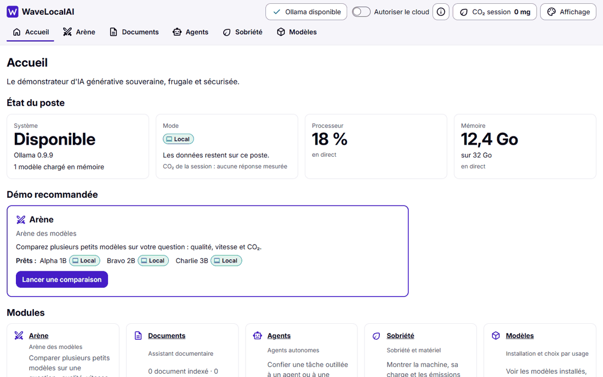
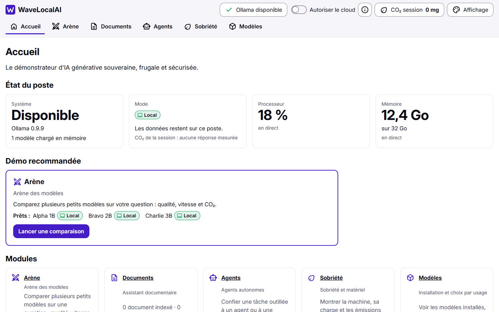
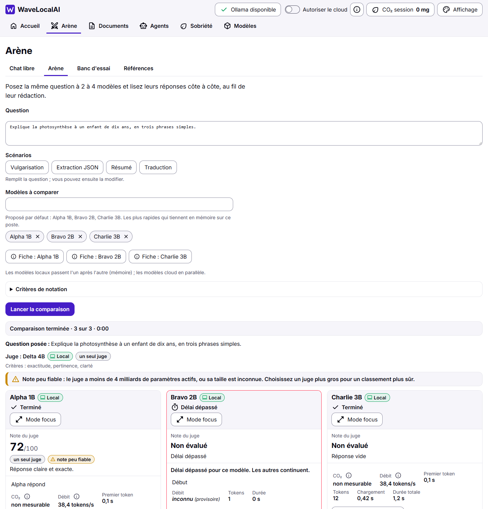
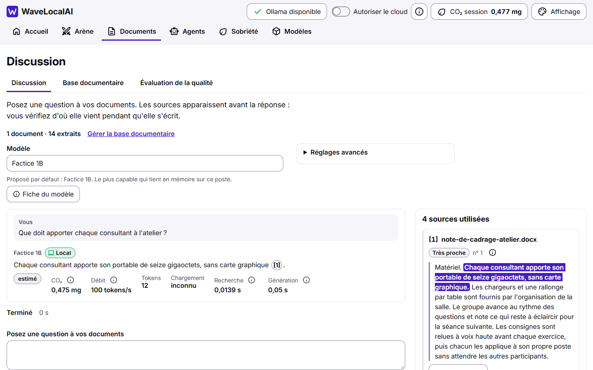
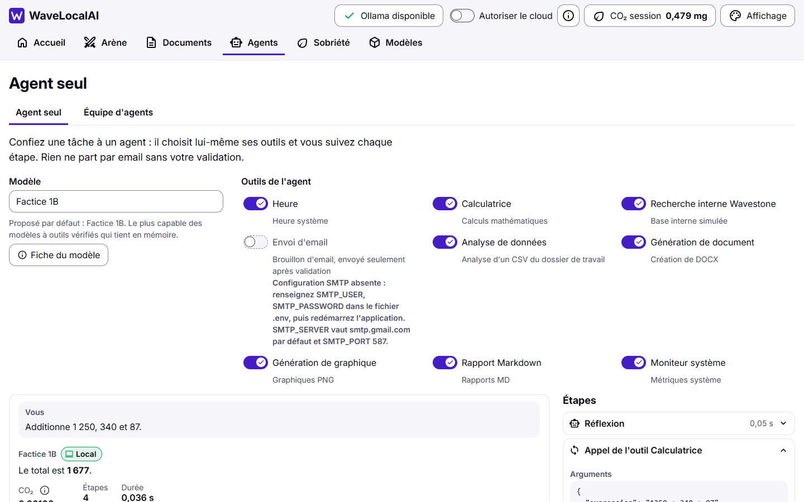
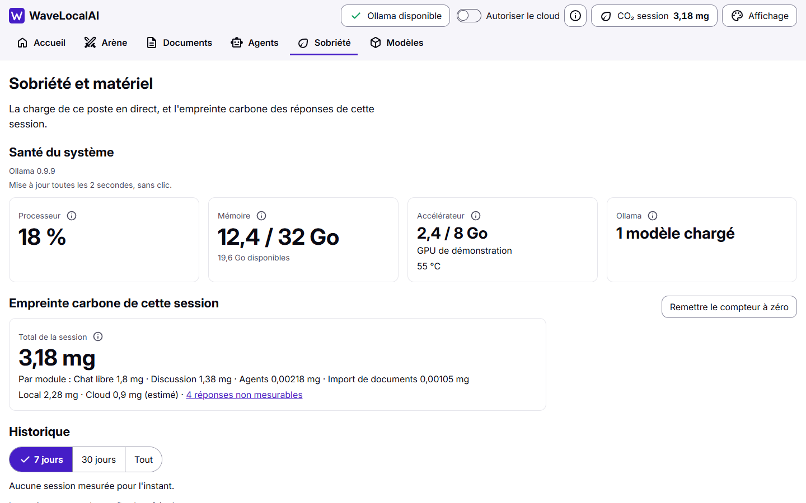
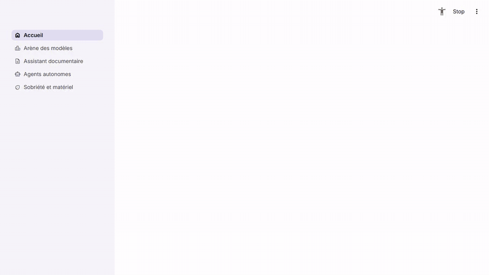

# 🌊 WaveLocalAI

**Workbench de démonstration d'IA locale et responsable**

[](https://www.python.org/downloads/)
[](https://streamlit.io/)
[](LICENSE)
[](#)
[](#)

> 💡 *Démonstration interactive des Small Language Models (SLM) pour Wavestone : Performance, Green IT et Souveraineté des Données.*



*La v2, en cinq captures à la suite : l'accueil et sa démo recommandée, l'Arène des modèles et son classement, la Discussion avec le passage source surligné, un agent qui appelle un outil, puis la Sobriété et matériel. Les captures viennent de doublures (modèles et réponses simulés, document fictif, aucune donnée réelle) : voir [Captures](#captures-de-la-v2).*

---

## La v2 (préversion)

La v2 est une application web locale (serveur FastAPI, interface sans compilation ni CDN) construite dans ce dépôt à côté de la v1 (Streamlit), qui reste livrée jusqu'à la bascule (story 8.4). Elle ouvre une coquille unique à six modules (Accueil, Arène, Documents, Agents, Sobriété, Modèles) et garde tout sur le poste. La liste de ce que la v1 faisait et de ce qu'il en advient : [`docs/parite-v1-v2.md`](docs/parite-v1-v2.md).

### Installation et lancement de la v2

Même installation que la v1 (voir [Installation](#installation-5-min) pour installer uv et Ollama), puis :

```powershell
git clone https://github.com/Aliquanto3/wavelocalai.git
cd wavelocalai

# Crée .venv et installe les dépendances aux versions figées de uv.lock (installation éditable)
uv sync

# Lance la v2 (la v1 se lance toujours par `uv run wavelocalai`)
uv run wavelocalai-v2
```

L'interface s'ouvre sur http://127.0.0.1:8502 (le port 8501 reste à la v1) : le serveur n'écoute que sur la machine locale. Options : `--port`, `--data-dir` (dossier des données, `data/` par défaut) et `--config` (un fichier `wavelocalai.toml`). Un modèle local reste à télécharger (`ollama pull qwen2.5:1.5b`) ; l'écran Modèles sait aussi les installer.

Tests de la v2 : `uv run python -m pytest tests/v2` (sans Ollama) ; les parcours dans un navigateur (`tests/v2/e2e`, marqueur `e2e`) se lancent avec `-m e2e` et tournent chaque nuit sur Linux dans la CI (voir `AGENTS.md`).

### Captures de la v2

| | |
|---|---|
|  |  |
|  |  |
|  | |

Ces images sont produites par [`scripts/readme_captures_v2.py`](scripts/readme_captures_v2.py) (Playwright, doublures des tests : modèles `fake`, faux Ollama, document fictif, dossier de données temporaire, aucune requête hors de 127.0.0.1). Aucun document ni extrait réel n'y figure ; le matériel affiché (processeur, mémoire, accélérateur) est fictif, jamais celui du poste qui a fait la capture.

---

## La v1 (Streamlit)

La v1 reste la version livrée tant que la v2 ne l'a pas remplacée ; sa documentation suit.



*En 40 secondes : on pose une question à un modèle et on voit sa vitesse et son CO₂, un agent outillé audite la machine, puis la page Sobriété suit la charge et les émissions. Vidéo source : [`docs/assets/demo.mp4`](docs/assets/demo.mp4). Cette capture utilise un modèle cloud ; l'usage visé reste un petit modèle local via Ollama.*

---

## 🎯 Vision & Objectifs

WaveLocalAI est un **proof of concept** conçu pour :

1. **🔒 Souveraineté des Données** : Tout reste sur votre machine (0 appel API par défaut)
2. **🌱 Green IT** : Mesure de l'impact carbone temps réel (CodeCarbon)
3. **📊 Comparabilité** : Benchmarks objectifs entre modèles locaux et cloud
4. **🤖 Autonomie** : Agents IA avec outils (calculatrice, recherche, génération de documents)

---

## ⚡ Quick Start

### Prérequis

- **uv** (installe Python lui-même ; 3.11 et 3.12 pris en charge)
- **Ollama** : [Télécharger ici](https://ollama.com/download)
- *Optionnel :* Clé API Mistral pour comparaison Cloud

### Installation (5 min)

L'installation passe par [uv](https://docs.astral.sh/uv/), sans droits administrateur : uv télécharge lui-même Python (3.12). Les versions exactes sont figées dans `uv.lock`.

```powershell
# 1. Installer uv (Windows, sans droits administrateur)
powershell -ExecutionPolicy ByPass -c "irm https://astral.sh/uv/install.ps1 | iex"
# Mac/Linux : curl -LsSf https://astral.sh/uv/install.sh | sh

# 2. Récupérer le projet (git clone, ou le zip du dépôt décompressé)
git clone https://github.com/Aliquanto3/wavelocalai.git
cd wavelocalai

# 3. Lancer l'application : le premier lancement crée .venv, installe les dépendances
#    et crée data/models.json depuis config/models_catalog.json
uv run wavelocalai

# 4. Télécharger un modèle local (Ollama doit être installé)
ollama pull qwen2.5:1.5b
```

Configuration optionnelle : `cp .env.example .env`, puis ajouter `MISTRAL_API_KEY` pour la comparaison Cloud.

Sur un réseau d'entreprise qui intercepte le HTTPS (proxy avec certificat maison), faire utiliser à uv le magasin de certificats du système, comme pour WaveStack : `$env:UV_SYSTEM_CERTS = "1"` avant `uv run`.

> **Machine de banc installée avant le passage à uv** : son `.venv` est encore le venv du banc, et `uv sync` ou `uv run` remplacerait son contenu par celui de l'application. Avant le premier `uv run`, recréer le banc dans `.venv-bench` (étape 2 de `docs/PROMPT_NOUVELLE_MACHINE.md`) puis supprimer l'ancien `.venv`. Ne pas se contenter de le renommer : sous Windows, les exécutables du venv (`hf.exe`) gardent le chemin de l'ancien dossier.

**Mettre à jour** : `git pull`, puis `uv sync` (ou directement `uv run wavelocalai`).

L'interface s'ouvre sur http://localhost:8501. Par défaut, le serveur n'écoute que sur la machine locale (`.streamlit/config.toml`, `server.address = "localhost"`) : aucune URL réseau n'est annoncée et la télémétrie Streamlit est coupée. Le lanceur se place lui-même à la racine du dépôt, car Streamlit ne lit `.streamlit/config.toml` que dans le répertoire courant, sinon le serveur écouterait sur le réseau.

**Ouvrir l'application sur le réseau** (démonstration depuis un autre poste) est un choix explicite, à faire au lancement uniquement, sur un réseau de confiance :

```powershell
uv run wavelocalai --server.address 0.0.0.0
```

Streamlit annonce alors aussi une « Network URL » : l'application et les documents indexés deviennent accessibles aux autres machines du réseau. Les arguments supplémentaires sont transmis à `streamlit run`.

**Sans uv** : créer un environnement et installer aux versions figées de `constraints.txt`, puis lancer Streamlit depuis la racine du dépôt.

```bash
python -m venv .venv-app
.venv-app\Scripts\python -m pip install -r requirements.txt -c constraints.txt   # Mac/Linux : .venv-app/bin/python
.venv-app\Scripts\python -m streamlit run src/app/Accueil.py
```

**Mettre à jour une dépendance** : modifier `pyproject.toml`, puis `uv lock` (et reporter le changement dans `requirements.txt`, puis régénérer `constraints.txt` avec la commande inscrite en tête du fichier, pour la méthode sans uv). Le venv du banc de benchmark est `.venv-bench` (voir `docs/PROMPT_NOUVELLE_MACHINE.md`).

**Tests** : `python -m pytest tests/unit tests/app` tourne sans Ollama, clé d'API ni réseau. `tests/integration` exige Ollama et `qwen2.5:1.5b` ; les tests marqués `e2e` sont exclus par défaut (`-m e2e` pour les lancer).

---

## 📚 Documentation

| Document | Description |
|----------|-------------|
| [Installation](docs/TROUBLESHOOT.md) | Guide détaillé et résolution d'erreurs |
| [Architecture](docs/ARCHITECTURE.md) | Structure technique du code |
| [Fonctionnalités](docs/FEATURES_GUIDE.md) | Guide utilisateur complet |
| [Configuration](docs/CONFIGURATION.md) | Variables d'environnement |
| [Contributing](CONTRIBUTING.md) | Guide de contribution |
| [Agent Tools](docs/AGENT_TOOLS.md) | **NOUVEAU** - Documentation des 9 outils agents |

---

## 🎯 Fonctionnalités

### 📋 Module 1 : Socle Hardware & Green IT
- Audit matériel (CPU, RAM, GPU)
- Monitoring carbone temps réel
- Dashboard de télémétrie

### 🧠 Module 2 : Inférence & Arena
- **Chat Libre** : Conversation avec mémoire contextuelle
- **Labo de Tests** : Benchmarks techniques (tokens/s, latence)
- **Model Manager** : Téléchargement et gestion des modèles Ollama
- **Support API Mistral** : Comparaison Local vs Cloud

### 📚 Module 3 : RAG Knowledge
- **Architecture Avancée** : Supporte Naive, HyDE et Self-RAG.
- **EvalOps Intégré** : Benchmark automatique "LLM-as-a-Judge" (Scores Fidélité/Pertinence).
- **Green RAG** : Mesure de l'impact CO2/RAM par requête.
- **Multi-Modèles** : Choix dynamique des Embeddings et Rerankers (Local SOTA).

### 🤖 Module 4 : Agent Lab ⭐ **NOUVEAU**
**Architecture rénovée avec support complet des modèles API**

#### **Mode Solo (Agent Autonome)**
- **9 outils disponibles** (anciennement 3) :
  - 🕒 **Time** : Heure système
  - 🧮 **Calculator** : Calculs mathématiques sécurisés
  - 🏢 **Wavestone Search** : Recherche interne simulée
  - 📧 **Email Sender** : Envoi d'emails via SMTP
  - 📊 **CSV Analyzer** : Analyse de données (Pandas)
  - 📝 **Document Generator** : Création de fichiers DOCX
  - 📈 **Chart Generator** : Génération de graphiques PNG
  - 📄 **Markdown Report** : Rapports structurés MD
  - 💻 **System Monitor** : Métriques CPU/RAM/Disque

- **Sélection dynamique d'outils** : Activez uniquement les outils nécessaires
- **Bibliothèque de 15+ prompts prédéfinis** organisés par catégorie
- **Support modèles API** : Mistral Large, Devstral, Ministral
- **Visualisation du raisonnement** : Chain of Thought visible

#### **Mode Crew (Multi-Agents)**
- **Workflows prédéfinis** : 8+ scénarios d'équipes optimisées
- **Composition flexible** : Jusqu'à N agents avec rôles, objectifs et backstories
- **Sélection d'outils par agent** : Chaque agent a ses propres outils
- **Mix Local/API** : Combinez modèles locaux et cloud dans une même équipe
- **Collaboration avancée** : Délégation et communication inter-agents
- **Logs nettoyés** : Historique complet avec codes ANSI supprimés

**Exemples de workflows Crew :**
- 📊 Étude concurrentielle (3 agents : Chercheur, Analyste, Rédacteur)
- 🔬 Pipeline d'analyse de données complète
- 📈 Rapport exécutif automatisé (4 agents)
- 🎯 Benchmark FinOps/GreenOps comparatif

---

## 🧪 Tests & Qualité

```bash
# Tests unitaires et rendu des pages (sans Ollama, clé d'API ni réseau)
python -m pytest tests/unit tests/app

# Avec couverture
python -m pytest tests/unit tests/app --cov=src.core --cov-report=html

# Tests d'intégration (exigent Ollama et qwen2.5:1.5b)
python -m pytest tests/integration -m integration

# Linting
ruff check src/ tests/
black --check src/ tests/
```

**Métriques actuelles :**
- ✅ **118 tests** (100 unitaires, 18 intégration)
- ✅ **86.5% de couverture**
- ✅ **0 vulnérabilité** critique

**Nouveaux tests :**
- Tests unitaires pour les 9 outils agents
- Tests d'intégration Agent Solo/Crew
- Tests de détection de modèles API vs Local
- Validation des workflows prédéfinis

---

## 🆕 Nouveautés Principales (Décembre 2024)

### 🔧 Architecture Modulaire des Outils
- **Module `model_detector.py`** : Source unique de vérité pour détecter API vs Local
- **Module `agent_tools.py`** : 9 outils avec métadonnées complètes
- **Pattern standardisé** : Fonction pure + wrapper LangChain + métadonnées UI

### 🎨 Refonte Complète des Interfaces
- **Solo** : Sélection d'outils + bibliothèque de prompts + guide intégré
- **Crew** : Workflows prédéfinis + multiselect outils par agent + logs améliorés
- **Cohérence visuelle** : Émojis 🏠 Local / 🌐 API dans tous les logs

### 🌐 Support API Unifié
- **Mistral Large 3** (675B paramètres, 41B actifs)
- **Devstral 2** (123B - Coding & Agents)
- **Ministral 3** (14B/8B/3B - Edge-friendly)
- **Mistral Small 3.2** (24B - General purpose)
- Détection automatique via `data/models.json`

### 📊 Gestion des Fichiers Générés
- Tous les fichiers créés par les outils → `outputs/`
- Nomenclature standardisée : `{type}_{timestamp}.{ext}`
- Support des images dans le chat (affichage direct des PNG/JPG)

---

## 🔧 Configuration Avancée

### Variables d'Environnement (.env)

```bash
# === Clés API (Optionnel) ===
MISTRAL_API_KEY=sk-proj-xxxxx  # Pour modèles Mistral API

# === SMTP pour Email Tool (Optionnel) ===
SMTP_SERVER=smtp.gmail.com
SMTP_PORT=587
SMTP_USER=votre-email@gmail.com
SMTP_PASSWORD=votre-app-password

# === Green IT ===
WAVELOCAL_COUNTRY_ISO=FRA  # FRA, DEU, USA...
WAVELOCAL_PUE=1.0          # 1.0=Local, 1.4=Datacenter

# === RAG ===
WAVELOCAL_EMBEDDING_MODEL=all-MiniLM-L6-v2

# === Chemins ===
WAVELOCAL_DATA_DIR=./data
WAVELOCAL_LOGS_DIR=./data/logs
```

### Télémétries

Par défaut, aucune télémétrie de bibliothèque n'est envoyée : `src/core/telemetry.py` coupe les télémétries des bibliothèques avant leur import, dans l'application comme dans les scripts (`scripts/setup_rag_models.py`) et les modules du cœur importés directement. Les autres échanges réseau restent possibles : premier téléchargement d'un modèle, appels aux fournisseurs cloud quand ils sont activés.

| Variable | Valeur posée | Ce qu'elle coupe |
|----------|--------------|------------------|
| `RAGAS_DO_NOT_TRACK` | `true` | Télémétrie de Ragas (évaluation RAG) |
| `ANONYMIZED_TELEMETRY` | `False` | Télémétrie de Chroma (base vectorielle) |
| `CREWAI_DISABLE_TELEMETRY` | `true` | Télémétrie de CrewAI (agents) |
| `OTEL_SDK_DISABLED` | `true` | Tout SDK OpenTelemetry du processus, dont celui de CrewAI (qui s'en sert aussi pour couper sa télémétrie) |
| `CREWAI_DISABLE_VERSION_CHECK` | `true` | Vérification de version de CrewAI auprès de pypi.org |
| `HF_HUB_DISABLE_TELEMETRY` | `1` | Télémétrie de Hugging Face (modèles d'embedding et reranker) |
| `LANGCHAIN_TRACING_V2` | `false` | Traces LangSmith (ancien nom) |
| `LANGSMITH_TRACING` | `false` | Traces LangSmith |
| `DO_NOT_TRACK` | `1` | Convention commune, lue par plusieurs bibliothèques (dont Hugging Face) |

La télémétrie de Streamlit est coupée à part, par `gatherUsageStats = false` dans `.streamlit/config.toml`.

**Réactiver une télémétrie** : définir sa variable soit dans l'environnement, soit dans le `.env`. Une valeur déjà définie l'emporte toujours (l'environnement d'abord, puis le `.env`) : elle n'est jamais écrasée. Par exemple, pour envoyer les traces à LangSmith (qui lit `LANGCHAIN_TRACING_V2` avant `LANGSMITH_TRACING` : définir les deux) :

```bash
# Dans le .env
LANGSMITH_TRACING=true
LANGCHAIN_TRACING_V2=true

# Ou dans l'environnement, avant le lancement
# Windows (PowerShell)
$env:LANGSMITH_TRACING = "true"; $env:LANGCHAIN_TRACING_V2 = "true"
# Mac/Linux
export LANGSMITH_TRACING=true LANGCHAIN_TRACING_V2=true
```

Certaines télémétries dépendent de plusieurs variables, dont chacune suffit à les couper :
- CrewAI reste coupé tant que `CREWAI_DISABLE_TELEMETRY` ou `OTEL_SDK_DISABLED` vaut `true` : définir les deux (`CREWAI_DISABLE_TELEMETRY=false` et `OTEL_SDK_DISABLED=false`). `OTEL_SDK_DISABLED=false` réactive aussi tout autre SDK OpenTelemetry du processus.
- Hugging Face lit aussi `DO_NOT_TRACK` : définir `HF_HUB_DISABLE_TELEMETRY=0` et `DO_NOT_TRACK=0`. `DO_NOT_TRACK=0` lève l'opt-out pour toutes les bibliothèques qui lisent cette convention, pas seulement pour Hugging Face.

### Reranker local de la v2 (optionnel)

La v2 (`wavelocalai-v2`, port 8502) peut reclasser les extraits trouvés avec un reranker local (fastembed, ONNX). **Elle ne télécharge jamais rien** : le reranker ne sert que s'il est déjà dans le dossier `data/models/fastembed` (sous le dossier de données de `wavelocalai.toml`). Sans lui, la recherche garde l'ordre des vecteurs, et « Réglages avancés » de la Discussion dit pourquoi (« Reclassement indisponible : … »).

Pour l'activer, deux actions explicites de votre part, hors de l'application :

```bash
# 1. Installer l'extra (fastembed)
uv sync --extra rerank
# 2. Remplir le cache une fois (télécharge le modèle, environ 1 Go, avec accès au réseau)
uv run --extra rerank python -c "from fastembed.rerank.cross_encoder import TextCrossEncoder; TextCrossEncoder(model_name='jinaai/jina-reranker-v2-base-multilingual', cache_dir='data/models/fastembed')"
```

Le modèle se règle dans `[rag] reranker_model` de `wavelocalai.toml` (multilingue par défaut, pour des documents en français) ; le nom donné au script ci-dessus doit être le même. La récupération depuis l'écran Modèles viendra avec l'Epic 5. Pour jouer le test d'intégration, qui saute sans le cache : `python -m pytest tests/v2/integration/test_rag_rerank_local.py`.

### Ajout d'un Nouveau Modèle

Éditer `data/models.json` :

```json
{
    "Mon Nouveau Modèle": {
        "ollama_tag": "mon-modele:latest",
        "type": "local",  // ou "api"
        "editor": "MonIA",
        "size_gb": "5.2 GB",
        "params_tot": "7B",
        "ctx": 8192,
        "capabilities": ["chat", "tools"],
        "role": "assistant_generalist",
        "desc": "Description du modèle"
    }
}
```

**C'est tout !** Le modèle sera automatiquement :
- Détecté comme Local ou API
- Affiché dans les sélecteurs
- Utilisable dans Solo et Crew

---

## 📖 Guide d'Utilisation Rapide

### 1. Chat Simple (Module 2)
```
1. Sélectionner "Inférence & Arena" dans la sidebar
2. Onglet "Chat Interactif"
3. Choisir un modèle (ex: Qwen 2.5 1.5B)
4. Poser une question
```

### 2. Agent avec Outils (Module 4 - Solo)
```
1. Sélectionner "Agent Lab" → Mode Solo
2. Choisir un modèle (ex: Qwen 2.5 3B)
3. Sélectionner les outils (ex: calculator, generate_chart)
4. Charger un prompt prédéfini OU écrire le vôtre
5. Exemple : "Crée un graphique avec les ventes [100, 150, 200]"
```

### 3. Équipe Multi-Agents (Module 4 - Crew)
```
1. Sélectionner "Agent Lab" → Mode Crew
2. Charger un workflow prédéfini (ex: "Pipeline analyse CSV")
3. Ajuster les modèles et outils si nécessaire
4. Lancer la mission
5. Observer la collaboration dans les logs
```

### 4. RAG sur Documents (Module 3)
```
1. Sélectionner "RAG Knowledge"
2. Uploader un PDF/TXT
3. Attendre l'ingestion (quelques secondes)
4. Poser des questions sur le contenu
5. Les sources exactes sont affichées
```

---

## 🤝 Contribution

Les contributions sont les bienvenues ! Consultez [CONTRIBUTING.md](CONTRIBUTING.md) pour :

- 🐛 Signaler un bug
- ✨ Proposer une fonctionnalité
- 🔧 Soumettre une Pull Request

**Processus :**
1. Fork le projet
2. Créer une branche (`git checkout -b feature/AmazingFeature`)
3. Commit les changements (`git commit -m 'Add AmazingFeature'`)
4. Push vers la branche (`git push origin feature/AmazingFeature`)
5. Ouvrir une Pull Request

**Code de conduite :** Soyez respectueux et constructif.

---

## 🗺️ Roadmap

### ✅ Complété (Décembre 2025)
- [x] Support complet des modèles Mistral API
- [x] 9 outils agents (Email, CSV, DOCX, Charts, etc.)
- [x] Workflows multi-agents prédéfinis
- [x] Sélection d'outils dynamique par agent
- [x] Détection unifiée API vs Local
- [x] Logs Crew nettoyés (codes ANSI)
- [x] Affichage des images dans le chat

### 🚀 Court Terme (Q1 2026)
- [ ] Support d'autres providers API (OpenAI, Anthropic)
- [ ] Évaluation automatique des réponses (LLM-as-a-Judge)
- [ ] Export des conversations en PDF/DOCX
- [ ] Mode comparaison side-by-side (Arena)
- [ ] Skills personnalisables (upload de SKILL.md)

### 🛠 Moyen Terme (Q2 2026)
- [ ] Dockerisation complète
- [ ] API REST pour intégration externe
- [ ] Dashboard administrateur (gestion users)
- [ ] Support des modèles multimodaux (Vision)

### 🔮 Long Terme (2026+)
- [ ] Mode "LLM Council" (vote entre modèles)
- [ ] Auto-tuning des prompts système
- [ ] Marketplace de workflows Crew

---

## 📝 Licence

Ce projet est distribué sous licence **MIT** - voir [LICENSE](LICENSE) pour plus de détails.

---

## 👤 Auteur

**Anaël Yahi**
Consultant en Transformation Numérique @ [Wavestone](https://www.wavestone.com/fr/)
Spécialité : IA Générative

- LinkedIn : [Anaël Yahi](https://www.linkedin.com/in/ana%C3%ABl-yahi/)
- GitHub : [@Aliquanto3](https://github.com/Aliquanto3)

---

## 🙏 Remerciements

- **Wavestone** pour le soutien au projet
- **Alibaba (Qwen Team)** et **IBM (Granite)** pour leurs modèles SLM exceptionnels
- **Mistral AI** pour leur API performante
- **Ollama** pour le runtime local
- **LangChain & LangGraph** pour les abstractions agents
- **CrewAI** pour l'orchestration multi-agents

---

## ⭐ Support

Si ce projet vous est utile, n'hésitez pas à :
- ⭐ Lui donner une étoile sur GitHub
- 🐛 Signaler des bugs ou proposer des améliorations
- 📢 Le partager avec vos collègues intéressés par l'IA locale

---

## 📊 Stats


---

## 📸 Captures d'Écran

### Agent Solo avec Génération de Graphique
```
[Image montrant : sélection d'outils, prompt, exécution, graphique affiché]
```

### Crew Multi-Agents en Action
```
[Image montrant : 3 agents collaborant, logs de délégation, résultat final]
```

### Comparaison Local vs API
```
[Image montrant : métriques côte à côte Qwen vs Mistral Large]
```

---

*Développé avec ❤️ pour la communauté IA & Data de Wavestone*

**Version :** 2.0.0 (Décembre 2024)
**Dernière mise à jour :** 15/12/2024
