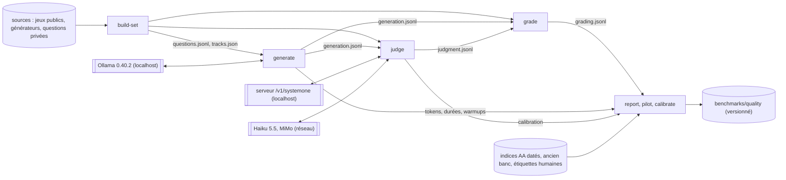
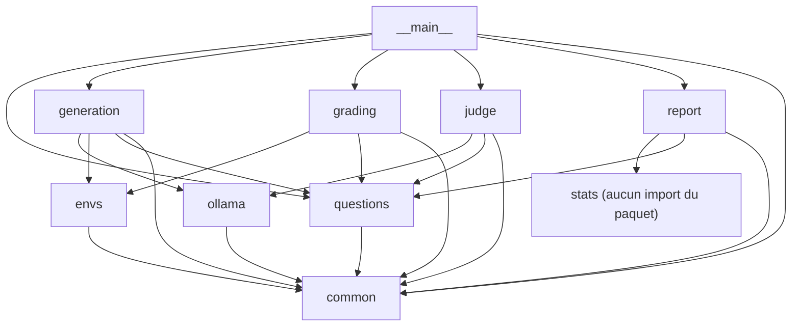
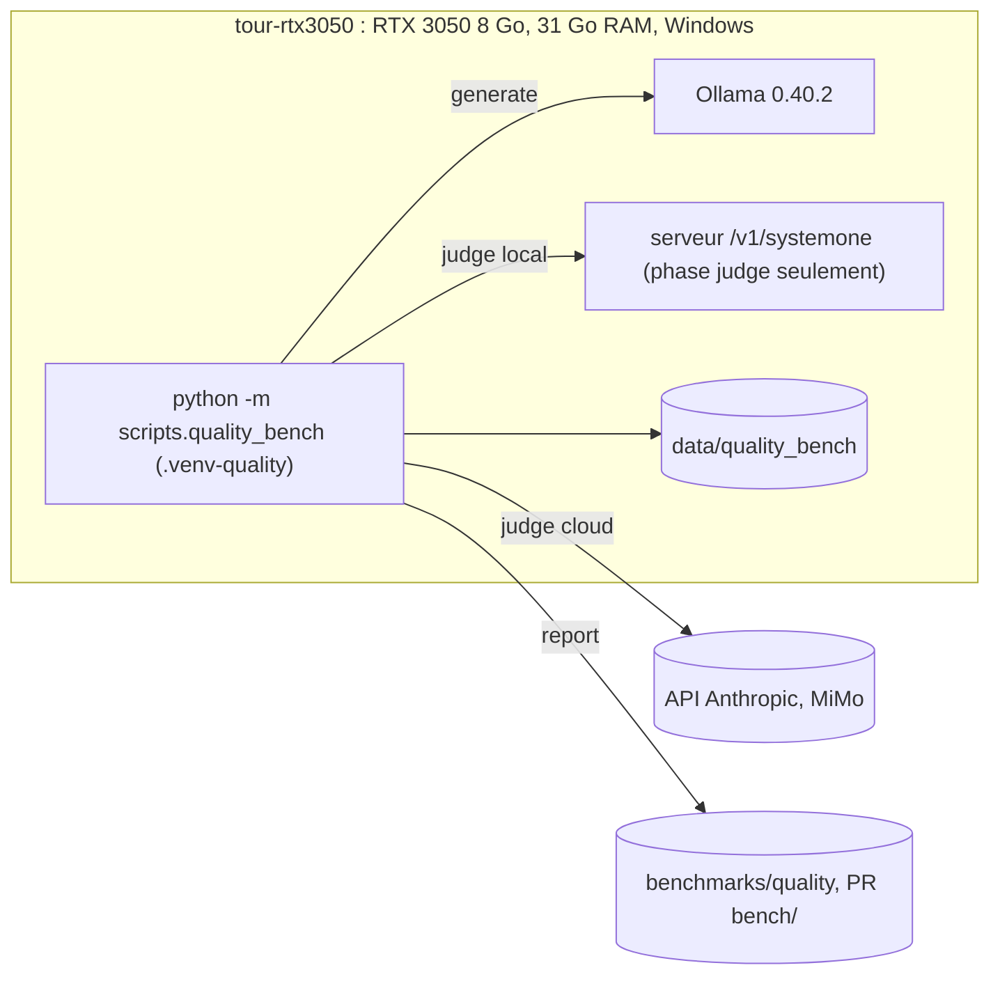

# Architecture Spine — Banc de qualité difficile (quality_bench)

## Design Paradigm

**Pipes-and-filters.** Six commandes, chacune une phase qui ne communique avec les autres **que par fichiers** : `build-set` → `generate` → `judge` → `grade` → `report` (dont `pilot` et `calibrate`). Aucune phase n'en appelle une autre en mémoire, et aucune commande n'en enchaîne plusieurs. Dans chaque phase, un **noyau fonctionnel** (schémas, correcteurs, environnements d'outils, statistiques : fonctions pures, sans I/O) est enveloppé par une **coquille impérative** (HTTP, fichiers, verrous, signaux, veille).



| Couche | Répertoire (sous `scripts/quality_bench/`) |
| --- | --- |
| Coquille : CLI | `__main__.py` |
| Coquille : I/O partagée | `common/` (canonique, jsonl, manifeste, verrous, arrêt, veille, chemins, configuration, schémas) |
| Coquille : HTTP Ollama | `ollama/` |
| Coquille : phases | `questions/` (construction du jeu), `generation/`, `judge/`, `report/` |
| Noyau pur | `questions/schema.py`, `envs/`, `grading/`, `stats/` |

## Invariants & Rules

### Sens des dépendances



Une flèche est une permission d'import ; toute autre est interdite. `generation/` n'importe jamais `grading/`, `judge/`, `stats/`, `report/` ni `questions/importers/`. Les phases se lisent par fichiers, jamais par import.

### AD-1 — Emplacement, isolement, langue [ADOPTED]

- **Binds:** all
- **Prevents:** un couplage au banc de vitesse qui fausserait ses comparaisons, un module hors du contrôle AST de télémétrie, ou deux langues d'identifiants.
- **Rule:**
  - Tout le code vit dans le paquet `scripts/quality_bench/` (avec `__init__.py`), lancé depuis la racine par `python -m scripts.quality_bench <commande>`.
  - Aucun import de `scripts/benchmark_slm.py` ni de `src/`, à une seule exception : `from src.core.telemetry import disable_telemetry` (AD-15). Les fichiers de l'ancien banc (`benchmarks/results/*.json`) ne sont lus qu'en lecture.
  - Identifiants en anglais : paquets, fonctions, champs JSON, valeurs fermées, sous-commandes (AGENTS.md ; les JSON de `benchmarks/results/` ont déjà des clés anglaises). Docs, journaux et textes des rapports en français.

### AD-2 — Un seul écrivain par fichier

- **Binds:** CAP-1 à CAP-8
- **Prevents:** deux unités qui écrivent le même fichier, ou un lecteur qui modifie le fichier d'un autre.
- **Rule:** chaque fichier a un propriétaire unique, seul autorisé à l'écrire. Les chemins de données sont relatifs à `$QUALITY_BENCH_DATA` (défaut `data/quality_bench/`, déjà ignoré par git).

| Fichier | Propriétaire | Mode |
| --- | --- | --- |
| `sources/<slug>/…` (candidats) | l'importeur ou le générateur `<slug>`, un seul par slug | réécrit |
| `sets/<set>/questions.jsonl`, `tracks.json` ; `benchmarks/quality/sets/<set>/index.jsonl` | `questions/set_builder.py` | écrit une fois ; refus si le dossier existe |
| `campaigns/<c>/manifest.json`, `generation.jsonl`, `warmups.jsonl` | `generation/` | ajout seul + `fsync` |
| `campaigns/<c>/judgment-<judge>/manifest.json`, `judgment.jsonl`, `batches.jsonl` | `judge/` | ajout seul + `fsync` |
| `campaigns/<c>/grading.jsonl` | `grading/` | réécrit en entier (temporaire + `os.replace`) |
| `campaigns/<c>/log-<commande>.log` | la commande nommée | ajout |
| `benchmarks/quality/<c>/…`, `benchmarks/quality/calibration/…` | `report/` | réécrit en entier |
| `calibration/labels.jsonl` | Anaël (saisie manuelle) | ajout |

  - Seul `common/jsonl.py` touche aux JSONL. `read_jsonl(path)` est en lecture seule : il ignore un fragment final sans `\n`, s'arrête sur toute autre ligne illisible et ne modifie jamais le fichier. `open_for_append(path, lock)` est réservé au détenteur du verrou du fichier (AD-12).

### AD-3 — Le score ne vit que dans `grading.jsonl` [ADOPTED]

- **Binds:** CAP-2, CAP-4, CAP-5, CAP-7
- **Prevents:** deux sources de score (runner et recorrection) qui divergent après un correctif de correcteur.
- **Rule:**
  - `generation.jsonl` est brut : aucun score, aucune réponse analysée.
  - `grading/` est le seul producteur de `score` et de `success`, rédaction comprise (il lit les verdicts du juge retenu).
  - `stats/` et les rapports de campagne lisent `grading.jsonl`, plus `generation.jsonl` pour les tokens et les durées. Seul `report/calibration.py` lit `judgment.jsonl` et `labels.jsonl`.
  - La jointure par `key` redonne l'enregistrement complet d'une question.

### AD-4 — JSON canonique, clés, graines, empreintes

- **Binds:** all
- **Prevents:** des clés ou des empreintes calculées différemment par le jeu, le runner, le juge et le rapport.
- **Rule:**
  - **JSON canonique :** `json.dumps(obj, sort_keys=True, ensure_ascii=False, separators=(",", ":"), allow_nan=False)` encodé en UTF-8. Empreinte = `sha256` hexadécimal minuscule. Seule implémentation : `common/canonical.py`. Toute chaîne est normalisée en NFC à l'entrée du jeu. Une cible numérique est un entier ou une chaîne, jamais un flottant.
  - **Clé de génération :** `"{campaign}|{model}|{track}|{question_id}|{seed}"`. Aucun composant ne contient `|` (contrôle à la construction).
  - **Clé de jugement :** `"{generation_key}|{criterion}"`. Les étiquettes humaines utilisent la même clé.
  - `seed` est la graine **de requête** envoyée à Ollama, celle de la clé de reprise. `generator_seed` est la graine **du générateur** de la question.
  - K > 1 : `seed = seed_base + epoch`. Un rejeu à graine identique (stabilité du pilote) se fait dans une **campagne distincte** `<c>-replay`, jamais dans le même fichier.
  - `prompt_hash` = empreinte de `{messages, turns, tools, format, env, num_ctx}`. `target_hash` = empreinte de `{target, criteria}`. `question_hash` = empreinte de la ligne entière, champs d'empreinte exclus. L'empreinte du jeu porte sur `{questions: [[id, question_hash] triés par id], tracks: tracks.json}`.
  - `question_id` est opaque et ne dérive jamais du contenu (`<usage>/<source>/<numéro>`).

### AD-5 — Schéma de question `qb.question/1`

- **Binds:** CAP-1, CAP-2, CAP-4, CAP-5
- **Prevents:** un import public et un générateur privé qui produisent des questions que le runner ou un correcteur lisent différemment.
- **Rule:** une ligne de `questions.jsonl` par question, exactement ces champs, définis dans `questions/schema.py` :

```json
{
  "schema": "qb.question/1",
  "id": "tools/bfcl-multi/0042",
  "usage": "reasoning | instructions | tools | extraction | rag | abstention | writing",
  "group": "bfcl-multi/conv-17",
  "unit": "tools/bfcl-multi/0042",
  "source": "bfcl-multi",
  "license": "Apache-2.0 | MIT | CC-BY-4.0 | ODC-BY-1.0 | public-domain | private",
  "private": false,
  "generator": "oneruler_fr@1",
  "generator_seed": 1234,
  "num_ctx": 16384,
  "est_prompt_tokens": 12000,
  "messages": [{"role": "system", "content": "…"}],
  "turns": [[{"role": "user", "content": "…"}]],
  "tools": null,
  "format": null,
  "env": {"name": "bfcl_filesystem", "initial_state": {}},
  "grader": {"name": "bfcl_ast", "params": {}},
  "target": null,
  "criteria": [{"id": "c1", "question": "La réponse reste-t-elle en français ?"}],
  "question_hash": "…",
  "prompt_hash": "…",
  "target_hash": "…"
}
```

  - Les champs sans objet valent `null` : `generator` et `generator_seed` hors questions générées, `turns` hors multi-tours, `env` hors outils exécutés, `criteria` hors rédaction.
  - `unit` = unité de score : `id` par défaut. Pour VAR-MATH, toutes les variantes d'un problème partagent une `unit`, réussie seulement si toutes ses questions le sont (agrégation dans `stats/`, AD-17). Une `unit` ne franchit jamais un `group`.
  - `num_ctx` fait partie des `num_ctx_tiers` de la configuration, et `num_ctx ≥ est_prompt_tokens × 1,25 + plafond maximal de num_predict` (contrôle de `set_builder`).
  - `grader.name` n'a pas de version : la version vit dans le registre et dans `grading.jsonl` (AD-10).
  - Liste fermée des `source` (slugs) dans `questions/schema.py`, chacune avec un seul producteur, plus une liste des sources refusées (exclusions de `pistes-et-questions.md`). Une question dérivée (traduction, variante) garde le `group` de son origine.
  - `tracks.json` : `{"think_off": [ids], "think_on": [ids]}`, `think_on` ⊂ `think_off`, tirage stratifié par usage **par groupes entiers**, graine dans `sets/<set>.yaml`.
  - Les questions de rédaction, non privées, sont versionnées en entier dans `scripts/quality_bench/questions/writing/`.

### AD-6 — Exports versionnés en liste blanche

- **Binds:** CAP-1, CAP-7
- **Prevents:** une question privée, une cible devinable ou une réponse brute qui fuit dans le dépôt public.
- **Rule:** seuls ces schémas fermés s'écrivent sous `benchmarks/quality/`, par `report/` et `set_builder` ; tout champ hors liste est une erreur.
  - `qb.set_index/1` : `id, usage, group, unit, source, license, private, question_hash`, plus `prompt_hash, target_hash` **pour les seules questions publiques**.
  - `qb.score/1` : `question_hash, model, digest, track, seed, status, score, success, metrics`. `metrics` ne contient que des flottants finis. Fichiers découpés par modèle : `benchmarks/quality/<c>/scores/<model>.jsonl`.
  - Manifestes, agrégats et rapports ne contiennent ni texte de question ni sortie de modèle.
  - Un test de `tests/quality_bench/` parcourt tout `benchmarks/quality/` et vérifie les clés de chaque ligne.
  - Aucune clé d'API dans un fichier : clés par l'environnement (`ANTHROPIC_API_KEY`, `MIMO_API_KEY`).

### AD-7 — Ligne de génération `qb.generation/1`

- **Binds:** CAP-2, CAP-3, CAP-8
- **Prevents:** un correcteur, un juge ou un rapport qui cherchent la réponse, les tokens ou la troncature à des endroits différents.
- **Rule:** une ligne par (modèle, piste, question, seed), exactement ces champs :

```json
{
  "schema": "qb.generation/1",
  "key": "pilot-20261015|qwen3.5:4b|think_on|tools/bfcl-multi/0042|0",
  "manifest": "<empreinte du bloc blocking>",
  "campaign": "pilot-20261015",
  "model": "qwen3.5:4b",
  "digest": "sha256:…",
  "track": "think_off | think_on",
  "question_id": "tools/bfcl-multi/0042",
  "usage": "tools",
  "group": "bfcl-multi/conv-17",
  "unit": "tools/bfcl-multi/0042",
  "prompt_hash": "…",
  "seed": 0,
  "epoch": 0,
  "think": true,
  "backend": "ollama",
  "ollama_version": "0.40.2",
  "num_ctx": 16384,
  "num_predict": 2048,
  "status": "ok | truncated | context_exceeded | error",
  "output": [
    {"turn": 0, "role": "assistant", "content": "…", "thinking": "…", "tool_calls": []},
    {"turn": 0, "role": "tool", "content": "…"},
    {"turn": 1, "role": "user", "content": "…"}
  ],
  "call_cap_reached": false,
  "tokens": {"prompt": 0, "prompt_cached": 0, "completion": 0, "thinking_est": 0, "answer_est": 0},
  "durations_ns": {"total": 0, "load": 0, "prompt_eval": 0, "eval": 0},
  "wall_s": 0.0,
  "calls": 1,
  "attempts": 1,
  "error": null,
  "created_at": "2026-10-15T08:12:03Z"
}
```

  - `output` = tous les messages postérieurs à `messages`, tours utilisateur injectés compris, chacun annoté `turn`.
  - `call_cap_reached` = la borne `max_tool_calls_per_turn` a été atteinte.
  - `tokens.prompt`, `prompt_cached` et `completion` = sommes de `prompt_eval_count`, `prompt_eval_cached_count` et `eval_count` sur les appels de l'essai réussi (ils font foi). `thinking_est` et `answer_est` = fragments du flux comptés par champ : ce sont des estimations, car Ollama ne compte pas à part les tokens de réflexion (issue #17843).
  - `status = truncated` dès qu'un appel renvoie `done_reason == "length"`. `num_predict` est le plafond **par appel**.
  - `status = context_exceeded` si `prompt + prompt_cached ≥ num_ctx − num_predict` sur un appel, ou si le préflight (AD-9) a écarté le palier pour ce modèle (ligne écrite sans requête).
  - `think` = valeur envoyée, `null` seulement si le modèle n'a pas la capacité thinking.

### AD-8 — Configuration et manifeste `qb.manifest/1`

- **Binds:** CAP-3, CAP-5, CAP-6, CAP-8
- **Prevents:** une reprise qui mêle deux jeux, deux configurations, deux versions d'Ollama, un modèle retéléchargé ou un harnais modifié ; un choix de juge qui bloque la génération.
- **Rule:** seul `common/config.py` lit les YAML et produit une configuration résolue (valeurs par défaut appliquées). Seul `common/schemas.py` définit les schémas de ligne et de manifeste.
  - `scripts/quality_bench/sets/<set>.yaml` décrit les sources, les effectifs et les graines du jeu.
  - `scripts/quality_bench/judges.yaml` décrit chaque juge (identifiant, point d'accès, modèle, réglages, seuils, gabarit de prompt).
  - `scripts/quality_bench/campaigns/<c>.yaml` contient deux sections :
    - `generation` : bloquante en entier ;
    - `grading` : non bloquante, elle désigne le juge retenu (`judge`), consigné avant la campagne complète.

```yaml
set: set-v1
generation:
  request: {temperature: 0, seed_base: 0, k: 1}
  caps: {think_on: {reasoning: 4096, default: 2048}, think_off: {default: 2048}}
  num_ctx_tiers: [4096, 8192, 16384, 32768]
  max_attempts: 3
  max_consecutive_errors: 5
  ollama_wait_s: 600
  max_tool_calls_per_turn: 8
  selection: null            # ou {ids: [...]} ou {sample: {per_usage: 20, seed: 7}}
  models:
    - {tag: "qwen3.5:4b", family: qwen, tracks: [think_off, think_on], think_off: false, think_on: true, num_ctx_max: 32768}
grading:
  judge: haiku
```

  - `manifest.json`, écrit au premier lancement puis comparé à chaque reprise :

```json
{
  "schema": "qb.manifest/1",
  "phase": "generation | judgment",
  "campaign": "pilot-20261015",
  "created_at": "2026-10-15T08:00:00Z",
  "blocking": {
    "set": {"id": "set-v1", "hash": "…", "n": {"think_off": 800, "think_on": 400}},
    "generation": {"hash": "…", "resolved": {}},
    "models_resolved": [{"tag": "qwen3.5:4b", "digest": "sha256:…", "family": "qwen", "capabilities": ["completion", "thinking", "tools"], "tracks": ["think_off", "think_on"], "think_off": false, "think_on": true, "num_ctx_max": 32768}],
    "ollama_version": "0.40.2",
    "machine": "tour-rtx3050",
    "harness_hash": "…",
    "judge": null,
    "generation_manifest": null
  },
  "informative": {"python": "3.12.8", "packages": {}, "code_commit": "…", "nvidia_driver": "…", "ollama_env": {}, "checklist": {}, "prices": null}
}
```

  - `generation.hash` porte sur la section `generation` résolue (un commentaire ne bloque pas). `harness_hash` = empreinte du contenu de `common/`, `ollama/`, `generation/` et `envs/`.
  - `models_resolved` est figé au premier lancement depuis `/api/show` et `/api/tags`. Si une piste de la configuration n'est pas permise par les capacités, le lancement est refusé, jamais une omission silencieuse.
  - Pour `phase = judgment` : `judge` = `{id, config_hash, endpoint, model, settings, prompt_template_hash, weights_sha256, server_version}` et `generation_manifest` = empreinte du `blocking` de génération lu.
  - Reprise refusée si une valeur de `blocking` diffère, avec le chemin JSON du premier champ différent dans le message (`blocking.models_resolved[3].digest`). `informative` ne bloque jamais.
  - Chaque ligne JSONL porte l'empreinte du `blocking` qui l'a produite. La version d'Ollama est relue après chaque retour du service : un changement arrête la campagne.
  - Modifier `generation` impose un nouvel identifiant de campagne.

### AD-9 — Hygiène de requête Ollama, propriété du seul client

- **Binds:** CAP-2
- **Prevents:** des requêtes construites à plusieurs endroits avec des paramètres implicites différents, ou une requête qui quitte la machine.
- **Rule:** seul `ollama/client.py` construit les requêtes.
  - **Transport :** `httpx2` synchrone, `POST /api/chat` en streaming, jamais `/v1`, jamais la bibliothèque `ollama`. URL de base limitée à `localhost` ou `127.0.0.1`.
  - **Paramètres :** chaque requête fixe explicitement `options.seed`, `options.temperature = 0`, `options.num_ctx`, `options.num_predict` (plafond de la piste et de l'usage) et `format` (schéma, ou `null` explicite).
  - **Préflight par modèle :**
    - lire `/api/show` ;
    - refuser un modèle distant (`remote_host` déclaré) ou sans `digest` dans `/api/tags` ;
    - exclure un modèle qui déclare `decision` ;
    - écarter les paliers au-delà du contexte maximal déclaré ou de `num_ctx_max` (AD-7).
  - **`think` :** envoyé seulement si la capacité `thinking` est déclarée, avec la valeur `think_off` en piste coupée et `think_on` en piste activée. Une valeur chaîne doit figurer parmi les valeurs déclarées.
  - **`tools` :** envoyé seulement si la capacité `tools` est déclarée.

### AD-10 — Contrat des correcteurs

- **Binds:** CAP-4, CAP-7
- **Prevents:** des correcteurs qui rendent des formes différentes, deux analyseurs de réponse, une recorrection non reproductible.
- **Rule:** tout correcteur est une fonction pure `grade(question, generation, verdicts=None) -> Grade`, enregistrée dans `grading/registry.py` sous `name@version`. Seul `grading/answer.py` extrait la réponse finale de `output` et décode le JSON (clôtures Markdown, balises de réflexion en ligne). Ligne `qb.grading/1` :

```json
{
  "schema": "qb.grading/1",
  "key": "…",
  "generation_manifest": "…",
  "judgment_manifest": null,
  "grader": "bfcl_ast@1",
  "status": "ok | truncated | non_compliant | context_exceeded | error | awaiting_judgment",
  "score": 1.0,
  "success": true,
  "metrics": {"f1": 0.92, "inline_thinking": 0.0}
}
```

| Usage | `success` (binaire) | `score` | Métriques continues |
| --- | --- | --- | --- |
| reasoning | réponse exacte ou numérique | = `success` | — |
| instructions | toutes les consignes vérifiées | = `success` | part de consignes vérifiées |
| tools | AST conforme ou état final attendu | = `success` | — |
| extraction | schéma valide et toutes les valeurs attendues | = `success` | F1 par champ |
| rag | correspondance exacte normalisée | = `success` | F1 |
| abstention | abstention correcte | = `success` | — |
| writing | `null` | moyenne des verdicts vrais sur **tous** les `criteria` | — |

  - `truncated`, `non_compliant` (JSON hors schéma, appel d'outil invalide, `call_cap_reached`) : `score = 0`, `success = false` (rédaction : `null`). Ce sont des échecs du modèle, comptés à part.
  - `error`, `context_exceeded` : `score = success = null`. Les statistiques retirent la question des comparaisons qui impliquent ce modèle et publient le compte.
  - Rédaction : un critère sans verdict donne `awaiting_judgment`, un verdict en erreur donne `error`.
  - La sortie JSON est validée contre le schéma côté client (`jsonschema`), jamais supposée conforme parce que `format` a été envoyé. `inline_thinking` = texte de réflexion trouvé dans `content`.
  - `grading/registry.py` fixe `langdetect.DetectorFactory.seed = 0` avant tout chargement. Le code emprunté ne télécharge rien à l'import. Corriger deux fois le même fichier donne des octets identiques (test).

### AD-11 — Outils exécutés : environnement simulé partagé

- **Binds:** CAP-2, CAP-4
- **Prevents:** un runner et un correcteur qui simulent les outils différemment, ou un correcteur qui lit un état connu du seul runner.
- **Rule:** les environnements d'outils (`envs/`, purs, déterministes, versionnés `name@version` dans le registre) exécutent les appels pendant la génération et sont **rejoués** par le correcteur depuis `output` pour reconstruire l'état tour par tour. Le runner ne persiste aucun état d'environnement.

### AD-12 — Verrous, écriture et reprise des JSONL

- **Binds:** CAP-3, CAP-5
- **Prevents:** des doublons de clé, des lignes collées après un arrêt brutal, un verrou orphelin, deux phases qui se disputent le GPU ou le réseau pendant la génération.
- **Rule:**
  - **Verrous :** verrous de fichier du système (`msvcrt.locking` sous Windows, `fcntl.flock` ailleurs), libérés à la mort du processus. PID et heure de début ne sont écrits qu'à titre d'information.
    - `campaigns/<c>/generation.lock` est pris par `generate` ;
    - `campaigns/<c>/judgment-<judge>/judgment.lock` est pris par `judge` ;
    - `$QUALITY_BENCH_DATA/machine.lock` est pris, en exclusif, par `generate`, `judge` (local ou cloud) et `build-set` : jamais de téléchargement, d'appel réseau ni de second occupant du GPU pendant une génération ;
    - `grade` et `report` ne prennent aucun verrou machine.
  - **Écriture :** une ligne canonique + `\n`, fichier ouvert en `"ab"`, `flush` puis `os.fsync` après chaque ligne.
  - **Reprise :**
    - à l'ouverture, le détenteur du verrou tronque physiquement un fragment final sans `\n` (journalisé), et sa question est rejouée ;
    - l'ensemble des clés présentes est chargé et toute clé présente est sautée ;
    - écrire une clé déjà présente lève une exception.
  - **Statut `error` :** il est définitif (rejeu : voir Deferred).

### AD-13 — Arrêt, panne d'Ollama, veille, exploitation

- **Binds:** CAP-3
- **Prevents:** un arrêt qui perd la question en cours, une panne durable transformée en erreurs définitives, une machine en veille ou mise à jour pendant la campagne.
- **Rule:**
  - **Arrêt propre :**
    - SIGINT et un fichier `STOP` (`campaigns/<c>/STOP` pour `generate`, `campaigns/<c>/judgment-<judge>/STOP` pour `judge`) lèvent seulement un drapeau, lu **entre deux questions** (ou deux lots) ;
    - l'unité en cours se termine et s'écrit, le modèle est déchargé (`keep_alive: 0`), puis le processus sort avec le code 0 et supprime `STOP` ;
    - un `STOP` présent au lancement est supprimé et journalisé ;
    - un lot cloud en attente n'est pas annulé : il sera relu depuis `batches.jsonl`.
  - **Panne d'Ollama :**
    - le runner ne redémarre pas Ollama ; si le service ne répond pas (connexion refusée, 5xx), il attend `/api/version` jusqu'à `ollama_wait_s`, revérifie la version (AD-8), puis refait **toute** la question ;
    - service toujours absent : sortie avec un code non nul, **sans écrire de ligne** ;
    - `error` est réservé à l'échec propre à une question, service vivant, après `max_attempts` ;
    - `max_consecutive_errors` erreurs de suite arrêtent la campagne.
  - **Veille :** `SetThreadExecutionState(ES_CONTINUOUS | ES_SYSTEM_REQUIRED | ES_DISPLAY_REQUIRED)` est appelé depuis le thread principal au lancement de `generate` et de `judge`, et `ES_CONTINUOUS` seul dans un `finally`. Sans effet hors Windows.
  - **Avant campagne :** une liste de contrôle est consignée dans `informative.checklist` et affichée au lancement :
    - mises à jour automatiques d'Ollama coupées ;
    - Windows Update en pause pour la durée de la campagne ;
    - `OLLAMA_NUM_PARALLEL` absent ou à 1 ;
    - aucun autre usage du GPU ;
    - données NLTK et dépendances installées.

### AD-14 — Ordonnancement de la génération

- **Binds:** CAP-2, CAP-8
- **Prevents:** des rechargements à chaque question quand `num_ctx` change, des durées faussées par un chargement à froid, un rejeu dont l'ordre diffère de la campagne.
- **Rule:**
  - **Boucle :** modèle (ordre de la configuration) > piste (`think_off` puis `think_on`) > palier `num_ctx` croissant > question (ordre d'`id`), restreinte à `selection`.
  - **Chauffe :** une requête de chauffe, jetée et non écrite, à chaque nouveau couple (modèle, `num_ctx`). Elle est suivie d'une ligne dans `warmups.jsonl` : `{model, num_ctx, size, size_vram, prefill_tok_s, load_ns}` (lus dans `/api/ps` et la réponse). Un avertissement est journalisé sous un seuil de préremplissage de la configuration.
  - **Déchargement :** `keep_alive: 0` en fin de modèle.

### AD-15 — Réseau, télémétrie et données privées

- **Binds:** CAP-1, CAP-5, CAP-6
- **Prevents:** un appel réseau pendant la génération, une question privée envoyée à un juge cloud, une télémétrie émise.
- **Rule:**
  - **Bibliothèques réseau :** seul `judge/` importe `anthropic` ou `openai`. Seul `questions/importers/` importe `huggingface_hub` ou `datasets`, chaque fichier appelant `disable_telemetry()` (nom nu, niveau module) avant l'import et figurant dans `TELEMETRY_IMPORTERS` de `tests/unit/test_telemetry.py`. La story 2 y ajoute `datasets` à `TELEMETRY_ROOTS`.
  - **Test AST :** un test de `tests/quality_bench/` vérifie que les graphes d'import de `generation/` et de `grading/` n'atteignent ni `judge/`, ni `questions/importers/`, ni ces bibliothèques, ni `nltk.download`.
  - **Questions privées :** un juge cloud lève une exception sur toute question `private = true`, avant tout envoi.
  - **Téléchargements avant campagne :** jeux publics, données NLTK (`punkt`, `punkt_tab`, `stopwords`, `averaged_perceptron_tagger_eng`, sous `$QUALITY_BENCH_DATA/nltk_data` via `NLTK_DATA`) et poids du juge local (téléchargement manuel documenté, `sha256` comparé à `SHA256SUMS`).

### AD-16 — Phase de jugement

- **Binds:** CAP-5, CAP-6
- **Prevents:** un jugement qui re-juge après reprise, paie deux fois un lot cloud, juge des réponses inutiles ou dépend d'un serveur précis.
- **Rule:**
  - **Interface :** `Judge.judge(items) -> list[Verdict]`, avec une implémentation par entrée de `judges.yaml` : `winnow`, `mimo`, `haiku`, `decider` en repli. Lancement : `judge --campaign <c> --judge <id>`, un dossier `judgment-<id>/` par identifiant.
  - **Lignes jugées :** seulement celles où `usage = writing` et `status = ok`, une par critère. Ligne `qb.judgment/1` :

```json
{
  "schema": "qb.judgment/1",
  "key": "<generation_key>|c1",
  "generation_key": "…",
  "manifest": "…",
  "criterion": "c1",
  "judge": "haiku",
  "verdict": true,
  "probability": 0.91,
  "tokens": {"input": 0, "output": 0},
  "cost_usd": 0.0,
  "attempts": 1,
  "error": null,
  "created_at": "…"
}
```

  - **Local :** le juge est écrit contre le **contrat** `POST /v1/systemone` avec des questions `noul` (probabilité de vrai), sur une URL `localhost`, et non contre un serveur précis. `verdict = probability ≥ 0,5`. Il prend `machine.lock` (AD-12) et refuse de démarrer si `/api/ps` liste un modèle de génération chargé.
  - **Cloud :** Haiku 5.5 par le SDK `anthropic` (Message Batches, verdict par sortie structurée, effort et réflexion consignés dans `blocking.judge`, car la température n'est pas réglable) ; MiMo-V2.6-Pro par le SDK `openai` sur `https://api.xiaomimimo.com/v1`.
  - **Lots :** l'identifiant de chaque lot soumis et ses clés sont écrits dans `batches.jsonl` **avant** l'attente des résultats. Une reprise relit les lots en cours au lieu de les resoumettre.
  - **Cascade :** elle n'est pas un juge lancé. `report/calibration.py` la simule hors ligne depuis `judgment-winnow/` et `judgment-haiku/` pour régler ses seuils. Si elle est retenue, elle devient l'entrée `winnow-cascade-haiku@<seuils>` de `judges.yaml`.
  - **Juge retenu :** il est désigné par `grading.judge` du YAML de campagne. `grade` ne lit que le dossier de ce juge et écrit son empreinte dans `judgment_manifest`.

### AD-17 — Statistiques pures, unités, entrées hors ligne

- **Binds:** CAP-7, CAP-8
- **Prevents:** des tests calculés sur des unités différentes, un N gonflé par les seeds, un rapport publié sur une campagne incomplète ou qui dépend du réseau.
- **Rule:**
  - **Pureté :** `stats/` ne contient que des fonctions pures sur des tableaux, sans I/O, et n'importe que `numpy`, `scipy` et `statsmodels`. Toutes les méthodes de `statistiques.md` sont normatives, notamment :
    - McNemar exact par paire, avec différence, erreur-type appariée, IC à 95 % et corrélation entre modèles ;
    - Holm (`method="holm"`, explicite car la valeur par défaut est `'hs'`) sur les k−1 comparaisons au meneur ;
    - BH réservé à la matrice exploratoire ;
    - Wilson ;
    - erreurs-types groupées par `group` ;
    - bootstrap apparié à graine fixée pour les métriques continues ;
    - groupes indiscernables, rang approché et k̂_Bonferroni ;
    - taux de troncature publié à part ;
    - Spearman selon les règles de `statistiques.md` ;
    - ni Friedman/Nemenyi, ni test non apparié.
  - **Unité statistique :** (`model`, `track`, `unit`). Les questions d'une `unit` sont agrégées par minimum (score strict), puis les seeds par moyenne. La méthode (McNemar ou erreur-type appariée sur les moyennes) se choisit sur `generation.request.k`, jamais sur les lignes observées.
  - **Complétude :** le rapport calcule les clés attendues (`models_resolved` × pistes × `selection` × seeds) et refuse de publier s'il en manque, s'il reste des `awaiting_judgment`, ou si les empreintes de manifeste ne concordent pas, sauf avec `--partial`, qui marque le rapport comme partiel.
  - **Jointure entre campagnes** (rejeu du pilote) : sur (`model`, `digest`, `track`, `question_id`, `seed`), avec `prompt_hash` égal.
  - **Références hors ligne :** indices AA lus dans `benchmarks/quality/references/aa-<AAAA-MM-JJ>.json` (`{tag, index, status: measured|estimated, variant: reasoning|non_reasoning}`). Le fichier de l'ancien banc lu par le pilote est consigné dans le rapport par chemin et empreinte.

## Consistency Conventions

| Concern | Convention |
| --- | --- |
| Commandes | `python -m scripts.quality_bench build-set --set <s>` ; `generate --campaign <c>` ; `judge --campaign <c> --judge <id>` ; `grade --campaign <c>` ; `report --campaign <c> [--partial]` ; `pilot --campaign <c> --replay <c>-replay` ; `calibrate --campaign <c>`. `pilot` et `calibrate` ne font que lire et rapporter. Identifiants : `pilot-AAAAMMJJ`, `full-AAAAMMJJ`, `<c>-replay`. |
| Valeurs fermées | `usage` et `track` comme en AD-5 et AD-7 ; `family` libre mais déclarée par modèle (biais Qwen = `family == "qwen"`) ; noms de correcteurs et d'environnements `name@entier` dans les registres. |
| Schémas | Chaque ligne et chaque manifeste porte `schema: "qb.<type>/<n>"`. Un changement de champ incrémente `<n>`, et le lecteur refuse un `<n>` inconnu. |
| Dates et unités | ISO 8601 UTC avec `Z`, à la seconde ; durées d'Ollama en ns, durée murale en s ; coûts en USD. |
| Encodage | Tout `open()` texte passe `encoding="utf-8"` ; la console et les journaux sont reconfigurés en UTF-8. |
| Journal | `logging` vers `campaigns/<c>/log-<commande>.log` et la console, en français ; jamais de contenu de question privée. |
| Erreurs | Erreur du banc (`error`, `context_exceeded`, exception) ≠ échec du modèle (`truncated`, `non_compliant`, mauvaise réponse). Aucun `except` ne transforme l'un en l'autre. |
| Code emprunté | `grading/vendored/<projet>/` avec `LICENSE`, `NOTICE` s'il existe, et `PROVENANCE.md` (dépôt, commit, fichiers, modifications, téléchargements retirés). M-IFEval : fichiers FR seulement, avec un registre réduit (sans spaCy). BFCL : lien vers `MODEL_CONFIG_MAPPING` retiré. |
| Tests | Dossier `tests/quality_bench/` (avec `__init__.py`), sans Ollama ni réseau : Ollama simulé par `httpx2.MockTransport`, arrêt brutal par un `subprocess` tué. Une fixture `autouse` fixe `QUALITY_BENCH_DATA` sur `tmp_path`. Échantillons sous `tests/quality_bench/samples/` (`fixtures/`, `data/` et `lib/` sont ignorés par git). Le `conftest.py` exclut le dossier par `collect_ignore_glob`, avec un message, si les dépendances manquent. Le marqueur `integration` est désactivé sauf `QUALITY_BENCH_INTEGRATION=1`. Commande : `.venv-quality\Scripts\python -m pytest tests/quality_bench`. |
| Dépôt | La story 1 ajoute `.venv-quality/` à `.gitignore`, exclut `benchmarks/quality/` de `detect-secrets` et `grading/vendored/` de black, isort et ruff (`.pre-commit-config.yaml`). |
| Git | Code : branche `feat/quality-bench-<sujet>`, commits `Feat:`. Résultats : branche `bench/quality-<campagne>`, commits `Bench:`, PR qui ne touche que `benchmarks/quality/`. Fusion par merge commit, jamais de squash. |
| Rendu | Un graphique ou une page HTML produits par `report/` suivent la charte Wavestone (primaire `#451DC7`, icônes Material, aucun emoji décoratif). |

## Stack

| Name | Version |
| --- | --- |
| Python | ≥ 3.10, venv dédié `.venv-quality` |
| Ollama | 0.40.2, figé pour toute la campagne |
| httpx2 (client Ollama ; aussi tiré par les SDK) | ≥ 2.13.1 |
| numpy | ≥ 2.2 (2.2.6 dernière pour 3.10 ; 2.5.4 exige 3.12) |
| scipy | ≥ 1.15 (1.15.3 dernière pour 3.10 ; 1.18.1 exige 3.12) |
| statsmodels | ≥ 0.14.4 (dernière : 0.15.0) |
| jsonschema | ≥ 4.26.0 |
| pyyaml | ≥ 6.0.3 |
| python-dotenv (importé par `src/core/telemetry.py`) | ≥ 1.2.4 |
| pydantic, absl-py, langdetect, nltk, immutabledict, emoji, syllapy (IFBench, M-IFEval FR) | ≥ 2.14.0, ≥ 2.5.1, ≥ 1.0.9, ≥ 3.10.3, ≥ 4.3.1, ≥ 2.16.0, ≥ 0.8.0 |
| anthropic (Haiku 5.5, `claude-haiku-5-5`, Message Batches) | ≥ 1.13.0 |
| openai (MiMo-V2.6-Pro, `mimo-v2.6-pro`) | ≥ 3.28.0 |
| huggingface-hub, datasets (import des jeux, story 2) | ≥ 2.2.0, ≥ 5.1.0 |
| Winnow-E4B (`EldanRing/Winnow-E4B`, GGUF Q8_0) | publié le 2026-09-24 ; serveur à trancher à la story 7 |
| pytest | ≥ 9.1.1 |

Versions relevées sur PyPI, Hugging Face et GitHub le 2026-10-10. Elles sont déclarées par bornes inférieures dans `scripts/quality_bench/requirements.txt`, jamais installées dans `.venv` (banc de vitesse) ni dans `.venv-app`. Les versions réellement installées sont relevées dans `informative.packages` du manifeste.

## Structural Seed

```text
scripts/quality_bench/
  __init__.py
  __main__.py           # CLI : build-set, generate, judge, grade, report, pilot, calibrate
  requirements.txt
  campaigns/            # pilot-AAAAMMJJ.yaml, full-AAAAMMJJ.yaml (versionnés)
  sets/                 # set-v1.yaml (sources, effectifs, graines)
  judges.yaml
  common/               # canonical, jsonl, manifest, locks, stop, keepawake, paths, config, schemas
  ollama/               # client.py : /api/chat, /api/show, /api/tags, /api/ps, /api/version
  questions/            # schema.py, set_builder.py, importers/, generators/, writing/
  envs/                 # environnements d'outils simulés (BFCL)
  generation/           # runner.py : préflight, ordonnancement, chauffe, essais, reprise
  grading/              # registry.py, answer.py, un module par usage, vendored/{ifbench,mifeval_fr,bfcl}/
  judge/                # base.py, systemone.py, haiku.py, mimo.py, decider.py
  stats/                # wilson, mcnemar, holm, clustered, bootstrap, groups, spearman
  report/               # export, campaign.py, pilot.py (projection), calibration.py
tests/quality_bench/
benchmarks/quality/     # versionné : sets/<set>/index.jsonl, <campagne>/, calibration/, references/aa-*.json
data/quality_bench/     # hors dépôt : sources/, sets/, campaigns/, calibration/, nltk_data/, machine.lock
```



`machine.lock` (AD-12) garantit que la génération, le juge local, le juge cloud et les téléchargements ne se chevauchent jamais.

## Capability → Architecture Map

| Capability / Area | Lives in | Governed by |
| --- | --- | --- |
| CAP-1 Jeu difficile et non contaminé | `questions/` | AD-4, AD-5, AD-6, AD-15 |
| CAP-2 Génération sur les deux pistes | `generation/`, `ollama/`, `envs/` | AD-7, AD-9, AD-11, AD-14 |
| CAP-3 Campagne reprenable | `common/`, `generation/` | AD-2, AD-8, AD-12, AD-13 |
| CAP-4 Correction déterministe | `grading/`, `envs/` | AD-3, AD-10, AD-11 |
| CAP-5 Jugement découplé | `judge/` | AD-2, AD-8, AD-12, AD-15, AD-16 |
| CAP-6 Juge calibré | `report/calibration.py` | AD-3, AD-16 |
| CAP-7 Classement statistique | `stats/`, `report/` | AD-6, AD-10, AD-17 |
| CAP-8 Pilote | `report/pilot.py`, campagnes `pilot-*` et `pilot-*-replay` | AD-4, AD-8, AD-14, AD-17 |

## Deferred

- **Serveur du juge local (bloquant pour la story 7) :** `winnow-inference` n'est validé que sur Linux/CUDA et macOS (INSTALL.md) et demande 10 Go de VRAM ou plus en texte 8K. Trois options à mesurer : WSL2 avec CUDA, import de Winnow-E4B dans Ollama comme modèle `decision` (Ollama 0.40.2 sert `/v1/systemone`), ou Perplexity Decider hébergé. AD-16 tient pour les trois.
- **Test global d'une piste qui mêle binaire et rédaction :** interne à `stats/`, story 6. Le contrat `score`/`success` d'AD-10 suffit.
- **Rejeu des questions en `error` :** seulement si le pilote en montre. Il faudra alors un mécanisme qui respecte l'unicité des clés d'AD-12.
- **Désactivation du cache de préfixe d'Ollama par requête,** et confirmation du rechargement quand `num_ctx` change : à vérifier à la story 1 ou au pilote. `tokens.prompt_cached` permet déjà d'en tenir compte.
- **Stabilité du juge cloud** (non déterministe, température non réglable) : mesurée par rejeu à la calibration, story 9.
- **Seuils d'accord juge-humain et biais Qwen maximal :** fixés par Anaël à la story 9 (question ouverte de la spec). Le format détaillé de `labels.jsonl`, au-delà de la clé, se décide aussi à la story 9.
- **Revérification de l'API d'Ollama** (`format` avec `think`, issue #18774, comptage des tokens de réflexion, issue #17843) : le 2026-11-01, ou avant de figer le harnais si c'est plus tôt.
- **Déploiement, CI :** hors périmètre. Une seule machine et un lancement manuel ; la CI ne tourne pas sur `master`. L'exploitation se limite à AD-13.
