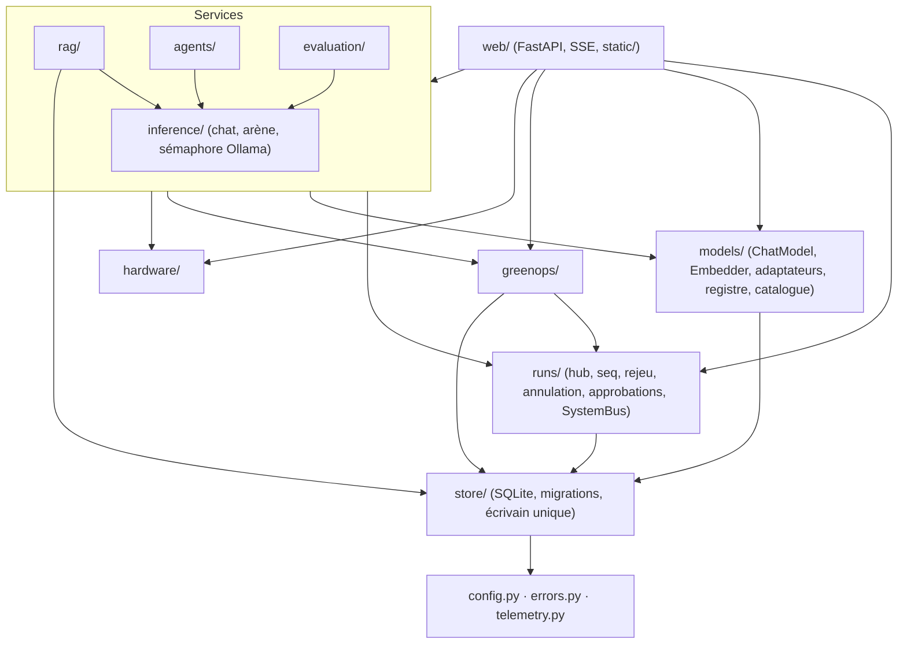
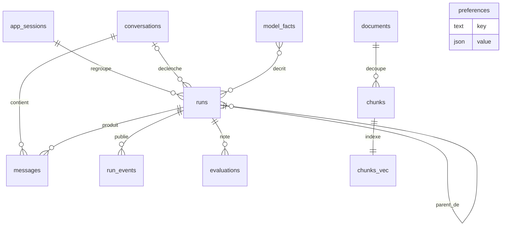
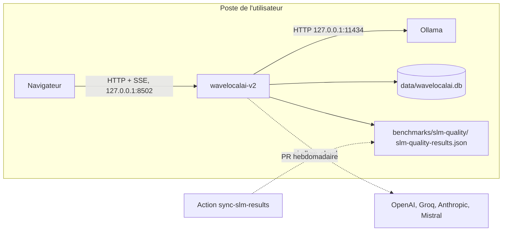

# Architecture Spine — wavelocalai v2

La spec et ses compagnons (pile imposée, contrat d'API, étapes) restent le contrat ; cette spine fixe ce qu'ils laissent ouvert et tranche leurs incohérences. En cas de conflit, un `AD` ci-dessous l'emporte sur `pile-technique.md` et `contrat-api.md`, à mettre à jour par `bmad-spec`.

## Design Paradigm

**Ports et adaptateurs (hexagonal) autour d'un hub d'exécutions.** Le cœur (services `inference`, `rag`, `agents`, `evaluation`) ne parle qu'à des ports (`ChatModel`, `Embedder`, `VectorIndex`, `SystemBus`, store) ; `web/` est l'unique adaptateur entrant ; Ollama, les SDK cloud, sqlite-vec, CodeCarbon et ecologits sont des adaptateurs sortants. Toute action longue ou en flux est un **run** publié par le hub `runs/` : le front ne connaît que des runs et leurs événements.



Une flèche = « peut importer ». `web/` peut importer tous les paquets ; aucun paquet n'importe `web/` ; tous peuvent importer `config.py`, `errors.py` et `telemetry.py`, qui n'importent rien du paquet.

## Invariants & Rules

### AD-1 — Python 3.11 minimum [ADOPTED]

- **Binds:** pyproject, CI, code v2
- **Prevents:** du code v2 en `tomllib`, `TaskGroup` ou `ExceptionGroup` testé ou lancé en 3.10, en fin de vie depuis octobre 2026.
- **Rule:** `requires-python = ">=3.11,<3.13"` pour tout le projet dès le premier lot (la v1 abandonne 3.10 avec lui). Cible `py311` seulement pour `src/wavelocalai/` et `tests/v2/` (configuration ruff propre) ; les réglages de lint globaux et `scripts/benchmark_slm.py` ne bougent pas. La borne haute ne se relève qu'à la bascule, après vérification.

### AD-2 — Coexistence v1 / v2 dans un seul projet

- **Binds:** pyproject, `uv.lock`, lanceurs, `src/`
- **Prevents:** une v2 qui dépend du `src/core/` de la v1 (et fausse le banc ou bloque l'archivage), deux lanceurs qui se marchent dessus, deux environnements.
- **Rule:** la v2 n'importe jamais `src.*` et la v1 n'importe jamais `wavelocalai` : ce qui est repris est copié puis adapté. Le paquet s'importe sous le nom `wavelocalai` grâce à `[tool.hatch.build] dev-mode-dirs = [".", "src"]` : **installation éditable seulement** jusqu'à la bascule (testé : `import wavelocalai`, `import src.core` et le script résolvent). Un seul `pyproject.toml`, un seul `uv.lock` : dépendances v2 dans `dependencies`, fastembed dans l'extra `rerank`. La v1 garde le script `wavelocalai` ; la v2 se lance par `wavelocalai-v2` (`wavelocalai.__main__:main`). À la bascule, les noms s'échangent, les dépendances de la v1 sortent et `packages` passe à `src/wavelocalai`.

### AD-3 — Une seule version par dépôt [ADOPTED]

- **Binds:** pyproject, tags, releases, correctifs v1
- **Prevents:** un `pyproject` qui annonce 1.3.x alors que `master` contient la v2, ou deux numérotations qui divergent.
- **Rule:** dès le premier lot, `version = "2.0.0.dev0"` (sans tag) ; puis une préversion à la fin de chaque étape, de `2.0.0a1` (étape 1) à `2.0.0a7` (étape 7), et `2.0.0` à la bascule (étape 8) ; ainsi `2.0.0a1` à la fin de l'étape 1 (`version = "2.0.0aN"` dans `pyproject.toml`, `uv.lock` et `CITATION.cff`, tag annoté `v2.0.0-alpha.N`, release GitHub avec notes). Un correctif v1 fusionné ensuite part avec la préversion suivante. Une branche `maintenance/1.3` n'est créée depuis `v1.3.0` que si une 1.3.x doit vraiment sortir.

### AD-4 — Sens des dépendances et frontière web

- **Binds:** tous les paquets de `src/wavelocalai/`
- **Prevents:** de la logique métier dans les routes, des services qui ne se testent qu'avec un serveur, un import lourd dans le chemin de rendu.
- **Rule:** les imports suivent le diagramme du paradigme. Seul `web/` importe `fastapi`, `starlette` ou `uvicorn`. Un test AST (`tests/v2/unit/test_layers.py`) vérifie le diagramme, l'absence de `src.*` et le caractère paresseux des imports lourds (`codecarbon`, `fastembed`, `pypdf`, `docx`, `ecologits`, SDK cloud) : importés dans la fonction qui s'en sert, jamais au niveau du module.

### AD-5 — Le run, unique modèle d'exécution, et son cycle de vie

- **Binds:** CAP-4 à CAP-12, `runs/`, toutes les commandes `POST …/runs`, ingestion, installation de modèle
- **Prevents:** deux modèles de tâche longue (runs et jobs) ; plusieurs stories qui créent la conversation, écrivent les messages ou fixent le statut chacune à sa façon ; des métriques comptées deux fois.
- **Rule:**
  - Toute génération, ingestion, installation, évaluation, équipe ou banc est un run créé par le hub `runs/`, **seul** à attribuer `seq`, publier, persister, annuler et fixer le statut. Pas de table `jobs`.
  - Un run racine porte un `kind` (`chat`, `arena`, `rag`, `agent`, `ingest`, `pull`, `eval`, `bench`). Un run composite a des runs enfants (`parent_run_id`), un par appel de modèle, juge compris ; **métriques et CO₂ ne vivent que sur les runs feuilles**. Le parent publie seul le flux. Annuler un parent annule ses enfants. Le parent finit `ok` si l'orchestration aboutit ; l'échec d'une lane reste dans son `lane_status`.
  - Une feuille porte un `kind` de feuille, liste close figée par la migration du hub : `generation` (tout appel `ChatModel` hors notation, HyDE et Self-RAG compris), `judge` (notation) et `embedding` (un lot d'embedding d'ingestion, l'embedding d'une question ou d'une évaluation). Une feuille `embedding` est mesurée comme toute feuille locale (AD-11). Le reclassement fastembed (CPU, hors port) n'est pas une feuille. Ceci remplace « `kind` (racines) » de `pile-technique.md`.
  - `GET /api/runs/{id}` rend l'instantané du run (statut, métriques des feuilles, erreur). Ce qui se calcule sur l'ensemble d'un run terminé y figure, pas dans le flux : pour un run `arena`, le `verdict` local/cloud calculé par le serveur ; le front le lit à `run_ended` et à la réouverture.
  - Statuts : `running`, `awaiting_approval`, `ok`, `error`, `cancelled`, `interrupted`. Aucun code d'erreur ne reprend un nom de statut. Au démarrage, chaque run non terminé reçoit un `run_ended {status: "interrupted"}` synthétique.
  - Conversation : le hub la crée avec le premier run (réponse `{run_id, conversation_id}`) ; son `kind` (`chat`, `rag`, `agent`) est fixe. Le hub écrit seul `messages` : message utilisateur à la création du run, message assistant (partiel compris) dans la transaction qui écrit le dernier lot d'événements et le statut final.
  - Le service termine une feuille par `hub.finish_leaf(result, co2)` ; il n'écrit jamais `runs` lui-même.

### AD-6 — Format des flux SSE

- **Binds:** `GET /api/runs/{id}/events`, `GET /api/system/stream`, `static/core/sse.js`
- **Prevents:** des écrans qui lisent les événements différemment, des doublons ou des trous à la reprise, un `EventSource` qui se reconnecte sans fin, plus de 6 connexions ouvertes vers le serveur.
- **Rule:**
  - Trame : `id: <seq>` puis `data: <enveloppe JSON>` ; **pas de champ `event:`** (un seul gestionnaire, aiguillage par `type`, type inconnu ignoré). Enveloppe `{seq, run_id, type, ts, data}`, `ts` en ISO 8601 UTC.
  - `seq` commence à 1, contigu par run ; `run_started` en premier, `run_ended` en dernier, une seule fois. Le client écarte tout `seq` déjà vu et ferme la connexion à `run_ended`.
  - `token` groupé par tranches de 50 ms au plus et par `lane`. `lane` = tag du modèle concerné, toujours présent sur `token`, `metrics`, `lane_status`, `judge_score`, `step` et `eval_metric` ; un même modèle ne figure qu'une fois par arène.
  - Reprise par l'en-tête `Last-Event-ID` ou le paramètre `?after=<seq>` : mémoire du hub si le run est actif, base sinon. Si le curseur atteint le dernier `seq` d'un run terminé, réponse `204`. Commentaire de maintien toutes les 15 s (`fastapi.sse.EventSourceResponse` natif, sans sse-starlette).
  - Le front n'ouvre un flux de run que pour les runs de l'écran monté ; en revenant sur un écran, il reprend avec `?after=`. `GET /api/system/stream` (état d'Ollama, système, `carbon_updated`, `runs_active` = liste `{run_id, kind, status}`) utilise la même enveloppe avec `run_id: null`, sans `id:` ni rejeu.
  - Nouvel événement de run : `approval_resolved {approval_id, decision: "approved" | "rejected" | "expired"}` (AD-9).

### AD-7 — Persistance des événements

- **Binds:** `runs/`, `store/`
- **Prevents:** une écriture SQLite par token, un rejeu qui perd la fin d'un run, du texte de document qui survit à sa suppression.
- **Rule:** le hub garde en mémoire tous les événements d'un run actif et les écrit dans `run_events` par lots (au plus chaque seconde, et le dernier lot avec `run_ended`, le statut et le message assistant dans une transaction). L'événement `sources` est persisté **sans `text`** ; au rejeu, le hub le réhydrate depuis `chunks` (`null` si le document a été supprimé, le front affiche « extrait supprimé »). `runs.params` ne contient aucun texte saisi : la question vit dans `messages` et `run_events`.

### AD-8 — Ports `ChatModel` et `Embedder`

- **Binds:** `models/` (4 adaptateurs + faux modèle), `inference/`, `agents/`, `evaluation/`, `rag/`
- **Prevents:** des adaptateurs qui mesurent, stockent ou filtrent chacun à leur façon ; un débit D3 calculé ailleurs que depuis Ollama ; une annulation qui laisse un flux HTTP ouvert ; des embeddings qui contournent le registre.
- **Rule:**

```python
class ChatModel(Protocol):
    ref: ModelRef  # tag, provider, origin, kind
    def stream(self, request: ChatRequest) -> AsyncIterator[ChatChunk]: ...

class Embedder(Protocol):
    ref: ModelRef
    async def embed(self, texts: list[str]) -> list[list[float]]: ...

ChatRequest = messages (rôle, contenu, appels d'outils, id d'appel), tools (schéma JSON neutre),
              temperature, max_tokens, think: bool, response_schema: dict | None
ChatChunk   = LoadState(phase: "loading" | "loaded", duration_s)
            | TextDelta(text, channel: "answer" | "thought")
            | ToolCall(id, name, arguments: dict)
            | Done(ChatResult)
ChatResult  = finish_reason, input_tokens, output_tokens, ttft_s, load_s, eval_s, total_s,
              tps, tps_source: "ollama_eval" | "wallclock"
```

  `Done` est émis une fois, en dernier. Annulation = annulation de la tâche asyncio ; l'adaptateur ferme son flux dans un `finally`. Un refus fournisseur lève `ProviderError(code)` (codes d'`errors.py`). Un adaptateur ne calcule pas de CO₂, n'écrit pas en base et ne lit pas `allow_cloud`. Seul l'adaptateur Ollama (`/api/chat` natif, client async partagé) produit `tps_source = "ollama_eval"` (`eval_count / eval_duration`, D3). Les embeddings sont locaux seulement (Ollama `/api/embed`). Un adaptateur `fake` scriptable, pour `ChatModel` et pour `Embedder` (vecteurs déterministes dérivés du texte, dimension fixe), n'est enregistré que si `Settings.testing` est vrai.

### AD-9 — Contrôle du cloud et des actions sensibles

- **Binds:** CAP-2, CAP-11, `models/registry.py`, `runs/`, `agents/`
- **Prevents:** une route ou un service qui oublie D1 ; un email envoyé sans validation (D2) ; un run bloqué sans fin en attente d'approbation.
- **Rule:** `registry.resolve(tag, allow_cloud)` et `registry.resolve_embedder(tag)` sont les seuls moyens d'obtenir un modèle ; un modèle `origin != "local"` sans `allow_cloud` lève `cloud_not_allowed` ; `allow_cloud` absent vaut faux. L'approbation est une entité du hub : `approval_required`, statut `awaiting_approval`, puis `approval_resolved` ; sans réponse en 10 minutes, `expired` vaut refus ; annuler le run vaut refus. Un outil marqué sensible ne s'exécute qu'après `approved` ; aucun chemin d'approbation automatique hors de l'adaptateur `fake`. Le run garde sa place de `kind` pendant l'attente.

### AD-10 — Forme du CO₂ et session carbone

- **Binds:** CAP-6, CAP-7, CAP-10, `greenops/`, événement `metrics`, table `runs`, exports
- **Prevents:** trois vocabulaires de méthode (contrat, table `runs`, front), un 0 affiché pour un inconnu, un total de session qui compte des parents ou perd des réponses effacées.
- **Rule:** le champ `co2` vaut partout `{mg: float | null, method: "codecarbon" | "ecologits" | "unmeasurable", estimated: bool, range_mg: {low, high} | null, allocation: "direct" | "prorata_tokens", reason: str | null}` (`reason` requis si `mg` est nul). Il remplace `local | ecologits | unknown` du contrat et `codecarbon | ecologits | estimation | unknown` de `pile-technique.md`. Chaque feuille locale a son propre tracker, donc `allocation = "direct"` ; `prorata_tokens` est réservé à une mesure partagée par plusieurs feuilles locales (aucune au MVP ; l'hypothèse de prorata de la spec est remplacée). Une `app_session` commence à chaque démarrage du serveur et à chaque remise à zéro ; CO₂ de session = somme des runs feuilles de la session courante, non-mesurables comptés à part ; `greenops` publie `carbon_updated` sur le port `SystemBus` (défini dans `runs/`) après chaque feuille.

### AD-11 — CodeCarbon et ecologits [ADOPTED]

- **Binds:** `greenops/`, CAP-6
- **Prevents:** des SDK instrumentés en douce, deux trackers simultanés, un appel réseau de mesure, un CO₂ vide présenté comme mesuré, un appel bloqué par sa mesure.
- **Rule:** CodeCarbon mesure chaque run feuille local avec `OfflineEmissionsTracker` (pays et PUE de `Settings`), démarré et arrêté sous le sémaphore Ollama (AD-14), un seul à la fois, `start`/`stop` dans le pool de threads ; un test sans socket le vérifie. Le cloud passe par `ecologits.tracers.utils.llm_impacts(provider=…, model_name=…, output_token_count=…, request_latency=…, electricity_mix_zone=…)`, appelé par arguments nommés après l'appel ; **jamais `EcoLogits.init()`**. Un résultat avec `errors` non vide ou une exception donne `unmeasurable`, raison tirée du code d'erreur. Correspondance : `anthropic`, `mistralai` et `openai` directs ; Groq par une table explicite de `wavelocalai.toml` vers l'entrée `huggingface_hub` du modèle ouvert (ex. `openai/gpt-oss-120b`) ; sans entrée, `unmeasurable`. Un test de contrat fige la signature. Aucune mesure n'interrompt un run.

### AD-12 — Store SQLite et migrations

- **Binds:** `store/`, tous les services qui persistent
- **Prevents:** deux écrivains concurrents (`database is locked`), un schéma modifié hors migration, une migration réécrite après coup, une base ouverte par un code trop ancien.
- **Rule:** un fichier SQLite (défaut `data/wavelocalai.db`), stdlib `sqlite3` + extension sqlite-vec, `journal_mode=WAL`, `foreign_keys=ON`, `secure_delete=ON`. **Un seul écrivain** : une connexion dédiée dont le store sérialise les écritures sur un fil unique ; lectures sur connexions courtes. Migrations : `store/migrations/NNNN_nom.sql`, avant seulement, appliquées au démarrage dans une transaction après copie `wavelocalai.db.bak-<user_version>`, version dans `PRAGMA user_version`. Une migration fusionnée n'est jamais modifiée ; une base dont `user_version` dépasse celle du code fait refuser le démarrage avec un message. **Seule exception écrite** : les tables vec0 `chunks_vec_<dim>`, créées par `store.ensure_vec_table(dim)` (idempotent, nom figé). Un test applique toutes les migrations sur une base vide et compare le schéma à un instantané versionné. La migration de la story du hub crée `runs`, `run_events`, `conversations`, `messages` et `app_sessions` en entier.

### AD-13 — « Effacer » efface

- **Binds:** CAP-5, CAP-7, CAP-8, `store/`, `runs/`
- **Prevents:** un texte supprimé qui reste dans le fichier, le journal WAL, les événements ou les vecteurs ; un total carbone qui baisse quand on efface.
- **Rule:** effacer une conversation ou un run supprime ses `messages`, `run_events` et `evaluations`, et garde les lignes `runs` (sans texte, `conversation_id` à `NULL`) comme registre carbone. Supprimer un document supprime ses `chunks` et, dans la même transaction, leurs lignes vec0 par `rowid` (pas de cascade sur une table virtuelle). « Vider » supprime puis recrée la table vec0. Ordre, dans la file de l'écrivain : `DELETE`, `wal_checkpoint(TRUNCATE)`, `VACUUM`, `wal_checkpoint(TRUNCATE)`. Effacer une cible qui a un run actif rend `409`. Un test vérifie l'absence du texte dans les octets du `.db` et du `-wal`.

### AD-14 — Concurrence et file Ollama

- **Binds:** `inference/`, `rag/`, `runs/`, `greenops/`
- **Prevents:** deux générations locales qui se disputent la RAM, une ingestion qui bloque le chat, une colonne d'Arène lente qui arrête les autres.
- **Rule:** le sémaphore « Ollama local » (1) se prend **par appel** (génération, lot d'embedding), pas par run : une ingestion et un chat s'intercalent. Au plus **un run racine actif par `kind`** ; un second rend `409 run_busy` avec le `run_id` actif, que le front rejoint. Arène : locaux en séquence par le sémaphore, cloud en parallèle ; le délai d'une lane court depuis l'acquisition du sémaphore (local) ou le départ de l'appel (cloud) ; une lane en échec ou hors délai n'arrête pas les autres. Travail CPU (pypdf, docx, ONNX) dans le pool de threads.

### AD-15 — Configuration, préférences et budgets de lecture

- **Binds:** `config.py`, `store/`, `models/registry.py`, routes de lecture
- **Prevents:** un réglage d'UI écrit dans un fichier versionné, deux sources pour un même réglage, une route de lecture bloquée par Ollama arrêté.
- **Rule:** `Settings` (pydantic) se charge une fois au démarrage depuis `wavelocalai.toml` (`tomllib`) puis `.env` (secrets), et ne change plus ; aucun `os.getenv` hors de `config.py`. Ce que l'UI modifie (stratégie RAG, découpe, reranker, défauts choisis) vit dans la table `preferences`, qui prime sur `Settings` pour ces seules clés. L'app n'écrit jamais `wavelocalai.toml`. La sonde Ollama a un délai d'1 s au plus ; son état reste en cache 5 s pour les routes de lecture et 1 s pour la sonde du flux système (2 s), qui dit ainsi « Ollama ne répond pas » en moins de 3 s ; `/api/models` se sert du cache (dernière liste d'Ollama, `model_facts`, catalogue `config/models_catalog.json` en lecture seule) rafraîchi en tâche de fond. Dans `/api/models`, le débit mesuré sur ce poste est la médiane du `tps` des feuilles `ok` en `ollama_eval` de la table `runs` pour ce tag (absent sans run) ; la précision vient de `qb.results/1` à partir de l'étape 5 (`null` avant) ; la méthode CO₂ disponible vaut `codecarbon` en local, `ecologits` pour un fournisseur direct ou un modèle Groq présent dans la table de correspondance, `unmeasurable` sinon. Un test de budget paramétré parcourt toutes les routes `GET` de l'app sans paramètre de chemin, hors flux SSE, et vérifie < 300 ms Ollama injoignable : une route ajoutée y entre d'elle-même.

### AD-16 — Base documentaire

- **Binds:** CAP-8, CAP-9, `rag/`
- **Prevents:** des vecteurs de dimensions ou de modèles mélangés, une question posée sur un document à moitié indexé.
- **Rule:** une base = un modèle d'embedding actif ; la table `chunks_vec_<dim>` (vec0, `rowid = chunks.id`) suit sa dimension ; changer de modèle impose « Vider » puis réimport. `documents.status` vaut `indexing`, `ready` ou `failed` ; seuls les `ready` sont interrogés. Changer d'embedding ou vider rend `409` si un run `ingest` ou `rag` est actif. `VectorIndex` a deux implémentations : sqlite-vec et un repli numpy pour les tests.

### AD-17 — Téléchargements et reranker [ADOPTED]

- **Binds:** CAP-9, CAP-10, extra `rerank`
- **Prevents:** un téléchargement au milieu d'une démo, un RAG cassé sans l'extra.
- **Rule:** aucun téléchargement implicite ; seules deux actions explicites de l'utilisateur téléchargent, chacune en run `pull` : installer un modèle Ollama, récupérer le modèle du reranker. Ollama n'ayant pas d'API de reranking, le reranker est fastembed (extra `rerank`), chargé avec `local_files_only=True` depuis le `cache_dir` du dossier de données. Extra absent, modèle absent ou `ValueError` au chargement : le RAG tourne sans reranker et l'écran dit pourquoi. Jusqu'à l'écran Modèles (étape 5), qui porte le run `pull` du reranker, celui-ci ne sert que si son cache est déjà rempli ; le README dit comment le remplir.

### AD-18 — Erreurs

- **Binds:** CAP-4, toutes les routes, `run_ended`, adaptateurs
- **Prevents:** des messages libres par route, une clé d'API dans un message.
- **Rule:** liste fermée de codes dans `errors.py`, chacun avec `message` et `action` en français ; enveloppe `{code, message, action, detail}` sur toute réponse en erreur et dans `run_ended.data.error`. `detail` est un objet : `technical` (texte affiché replié sous « Détails techniques ») et les clés machine propres au code, déclarées avec lui dans `errors.py` (`run_busy` : `run_id` ; `ram_guard` : `needed_gb`, `free_gb`, `suggested_model`) ; ses valeurs texte passent par le masquage de clé. Le front affiche `message` et `action` tels quels et tire de `detail` les boutons d'action prévus.

### AD-19 — Sécurité de l'API locale [ADOPTED]

- **Binds:** `web/`, CAP-1
- **Prevents:** qu'une page web visitée pilote le serveur local (DNS rebinding, CSRF) ; une télémétrie du framework.
- **Rule:** écoute sur `127.0.0.1` seulement ; toute requête dont l'en-tête `Host` n'est pas `127.0.0.1:<port>` ou `localhost:<port>` est refusée ; toute requête d'écriture dont l'`Origin` n'est pas la même origine est refusée ; aucun en-tête CORS. FastAPI est créé avec sa télémétrie désactivée (`tracing`, `metrics`, `logs`, `operation_spans`, `auto_configure` à `False`) et `FASTAPI_OTEL_AUTO_CONFIGURE=false` figure dans les opt-outs.

### AD-20 — Contrat du front

- **Binds:** `web/static/`, CAP-1 à CAP-14
- **Prevents:** des écrans bâtis selon deux motifs, une mesure recalculée dans le navigateur, une bascule cloud qui survit au rechargement.
- **Rule:** composants partagés = Custom Elements **sans Shadow DOM**, préfixe `wl-` ; écran = module ES qui exporte `mount(host, params)` et rend sa fonction `unmount`, chargé par `import()` à la première visite. Un seul client SSE (`core/sse.js`) et un seul store observable (`core/store.js`), qui garde l'état et le dernier `seq` des runs actifs. La bascule cloud vit dans le store seulement ; `localStorage` ne garde que thème, projection, volets et brouillons. Le front ne calcule aucune mesure, garde-fou mémoire compris (`hardware/` calcule besoin et `fits`) ; seuls le chronomètre et le débit provisoire sont locaux. Textes dans `static/i18n/fr.json`. Aucune dépendance JS tierce, sinon recopiée dans `static/vendor/` avec sa licence.

### AD-21 — Imports lourds et télémétrie

- **Binds:** tout le paquet
- **Prevents:** un premier rendu lent, une télémétrie tierce réactivée par la v2.
- **Rule:** démarrage du serveur sans importer d'outil lourd (AD-4). `wavelocalai/telemetry.py` (copie adaptée de la v1) coupe les télémétries ; `disable_telemetry()` est appelé juste avant tout import de fastembed ou de huggingface_hub, et le test AST de la v2 le vérifie.

### AD-22 — Lecture des résultats du banc (`qb.results/1`)

- **Binds:** CAP-10 (« Sur d'autres postes »), CAP-13, `models/catalog.py`
- **Prevents:** un téléchargement des résultats à l'exécution, un `null` affiché 0, un résultat attribué à d'autres poids que ceux installés.
- **Rule:** l'app lit seulement `benchmarks/slm-quality/slm-quality-results.json`, synchronisé par l'Action existante (`scripts/sync_slm_results.py`, validé contre le schéma au tag de la release) ; jamais par le réseau. Modèle pydantic `extra="ignore"` ; `schema` doit valoir `qb.results/1`, sinon références indisponibles avec raison. `results[]` se joint à `models[]` sur `(model, digest)` ; un modèle installé correspond par `(tag, digest)`, à défaut par tag avec la mention « autre version ». Un `null` s'affiche « inconnu » ou « non classé », jamais 0 ; les fractions de 0 à 1 s'affichent en pourcentage ; `energy` ne s'affiche que si `status = "measured"`.

### AD-23 — Exploitation [ADOPTED]

- **Binds:** `__main__.py`, `store/`, journaux
- **Prevents:** deux serveurs sur une même base, des journaux qui grossissent sans fin ou exposent des prompts, une base corrompue par une mise à jour.
- **Rule:** un processus local mono-utilisateur ; un verrou dans le dossier de données refuse un second serveur ; port occupé = message clair. Arrêt propre : les runs actifs passent à `cancelled`. Journaux `logging` en rotation (5 × 1 Mo) dans `data/logs/`, sans texte de prompt, de réponse ou de document au niveau INFO. Pas de retour arrière entre préversions (sauvegarde `.bak` d'AD-12). L'historique CSV d'émissions de la v1 n'est pas importé.

## Consistency Conventions

| Concern | Convention |
| --- | --- |
| Identifiants | `id` TEXT = `uuid4().hex` ; tag de modèle Ollama tel quel (`qwen3.5:2b`) ; id cloud `fournisseur/modèle` |
| Dates et durées | ISO 8601 UTC avec `Z` en base et en API ; durées en secondes, suffixe `_s` ; énergie `energy_wh`, CO₂ `mg` |
| Noms | code et JSON en anglais `snake_case` ; types d'événement en `snake_case` (`run_ended`) ; fichiers front en `kebab-case` ; textes en français |
| Routes | préfixe `/api/` ; commande = `POST /api/<module>/runs` qui rend `{run_id}` (et `conversation_id` si conversation) ; exports par extension (`.json`, `.md`, `.csv`) |
| Événements | noms et données du tableau de `contrat-api.md`, plus `approval_resolved` et `runs_active` ; enveloppe et règles d'AD-6 ; champ `co2` d'AD-10 |
| Journaux | `logging` stdlib, AD-23 ; clés masquées |
| Tests | `tests/v2/unit` (sans serveur), `tests/v2/web` (TestClient), `tests/v2/e2e` (Playwright et axe-playwright-python, déjà en dépendances de dev, marqueur `e2e`) ; Ollama réel = marqueur `integration` ; base de test en dossier temporaire, jamais `data/`. `pytest.ini` exclut `e2e` par défaut, donc la CI ne les lance pas : les E2E d'une story se lancent en local (`-m e2e`) avant sa PR |
| Fichiers | 600 lignes au plus (spec) |

## Stack

| Name | Version |
| --- | --- |
| Python | >=3.11,<3.13 (vérifié avec 3.11.17) |
| FastAPI (SSE natif `fastapi.sse`) | 0.143.5 |
| uvicorn | 0.54.0 |
| pydantic | 2.12.x (`>=2.9.0`, sous 2.13) jusqu'à la bascule : crewai de la v1 exige `pydantic<2.13` ; relevé à la version vérifiée lors de la bascule |
| ollama (client Python) | 0.6.3 |
| sqlite-vec | 0.1.9 |
| ecologits | 0.11.3 (épinglé `>=0.11.3,<0.12`) |
| fastembed (extra `rerank`) | 0.9.0 |
| SQLite (embarqué par CPython via uv) | 3.53.1 |

Versions vérifiées le 2026-10-18 par installation réelle (uv) et sur PyPI ; les SDK `openai`, `anthropic`, `mistralai`, `codecarbon`, `pypdf`, `python-docx`, déjà au `pyproject`, se revérifient à la story qui les utilise.

## Structural Seed

```text
src/wavelocalai/
  __main__.py      # lanceur wavelocalai-v2 : Settings, verrou, migrations, uvicorn sur 127.0.0.1
  config.py  errors.py  telemetry.py
  runs/            # hub : création, seq, diffusion, rejeu, annulation, approbations, SystemBus, persistance par lots
  models/          # port.py, ollama.py, openai_compat.py, anthropic.py, mistral.py, fake.py, registry.py, catalog.py (qb.results/1)
  inference/       # chat, arène, métriques D3, sémaphore Ollama
  rag/             # ingestion (pypdf, docx), découpe, index (sqlite-vec, numpy), reranker, stratégies
  agents/          # boucle d'outils, équipe, outils
  evaluation/      # juge, fidélité, pertinence
  greenops/        # CodeCarbon, ecologits, session carbone
  hardware/        # psutil, NVML, accélérateur, garde-fou mémoire
  store/           # db.py (écrivain unique), migrations/NNNN_*.sql, dépôts par table
  web/             # app.py, routes_*.py, sécurité locale, static/ (index.html, core/, components/, screens/, i18n/, fonts/, icons.svg, tokens.css)
tests/v2/{unit,web,e2e}/
wavelocalai.toml   # défauts versionnés ; .env pour les secrets
```



`model_facts` met en cache `/api/show` par (tag, digest) ; le registre des modèles se reconstruit en mémoire (cache d'Ollama, cloud depuis `Settings`, catalogue versionné et `qb.results/1` en lecture seule) et n'est pas une table.



| Exploitation | Choix |
| --- | --- |
| Environnement | un seul : le poste de l'utilisateur, un processus mono-utilisateur ; aucun hébergement |
| Installation | `uv sync` (+ `--extra rerank` en option), éditable ; aucun Node |
| Port | 8502 par défaut (8501 reste à la v1), configurable |
| Données | dossier configurable, défaut `data/` ; alerte au démarrage s'il est sous OneDrive |
| Redémarrage | `instance_id` nouveau à chaque démarrage ; runs en cours → `run_ended` `interrupted` |
| CI | job v2 : `setup-uv`, `uv sync --locked`, `pytest tests/v2`, Python 3.11 et 3.12, trois OS ; job v1 inchangé sauf la matrice sans 3.10 |

**Ratification du dépôt, au premier lot :** `AGENTS.md` (Python 3.11+, v1 en correctifs seulement, v2 décrite avec son lanceur et ses tests) ; `requirements.txt` et `constraints.txt` régénérés pour 3.11 ; condition Codecov passée de 3.10 à 3.11 ; `pytest.ini` inchangé (le marqueur `e2e` existe).

## Capability → Architecture Map

| Capability / Area | Lives in | Governed by |
| --- | --- | --- |
| CAP-1 Coquille | `web/`, `web/static/`, `hardware/` | AD-4, AD-6, AD-15, AD-19, AD-20, AD-21 |
| CAP-2 Cloud contrôlé | `models/registry.py`, `core/store.js` | AD-9, AD-20 |
| CAP-3 Sélecteur | `models/`, `wl-model-picker` | AD-8, AD-15, AD-20 |
| CAP-4 Runs rejouables | `runs/`, `core/sse.js` | AD-5, AD-6, AD-7, AD-14, AD-18 |
| CAP-5 Chat | `inference/`, `models/` | AD-5, AD-8, AD-13 |
| CAP-6 CO₂ | `greenops/` | AD-10, AD-11 |
| CAP-7 Arène | `inference/`, `evaluation/` | AD-5, AD-6, AD-10, AD-14 |
| CAP-8, CAP-9 Documents | `rag/`, `store/` | AD-7, AD-13, AD-16, AD-17 |
| CAP-10 Sobriété, Modèles | `greenops/`, `hardware/`, `models/` | AD-10, AD-17, AD-22 |
| CAP-11 Agents | `agents/`, `runs/` | AD-5, AD-8, AD-9 |
| CAP-12 Évaluation, banc | `evaluation/` | AD-5, AD-8 (`response_schema`) |
| CAP-13 Références | `models/catalog.py` | AD-22 |
| CAP-14 Bascule | pyproject, CI | AD-1, AD-2, AD-3 |

## Deferred

- **Détail des colonnes** de chaque table : fixé par la migration de la story qui crée la table, dans le cadre d'AD-5, AD-10, AD-12 et du diagramme ci-dessus.
- **Liste des codes d'erreur** : chaque story ajoute les siens à `errors.py` (AD-18).
- **Formats d'appel d'outils** et protocole de l'équipe : story Agents (étape 6), dans le port d'AD-8.
- **Borne haute de Python** : à la bascule (AD-1).
- **Résidu vectoriel dans le blob vec0** après suppression par `rowid` : à vérifier par le test d'octets de la story RAG ; « Vider » n'est pas concerné (AD-13).
- **Moteur llama-server** : hors plan jusqu'à la fin de l'étape 8 (spec).
- **Passage bmad-ux** : `03-ux-front.md` §3 est compagnon de la spec, prioritaire sur `EXPERIENCE.md` pour l'IA, avec `DESIGN.md` comme source des jetons ; mise à jour `bmad-ux` avant l'étape 5 (écran Modèles) ou si une recette révèle un manque.
- **Règles des défauts par usage** (`agent`, `rag` compris) : au contrat (`contrat-api.md`, Défauts), seuils calés sur `qb.results/1` à l'étape 5.
